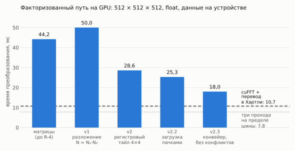
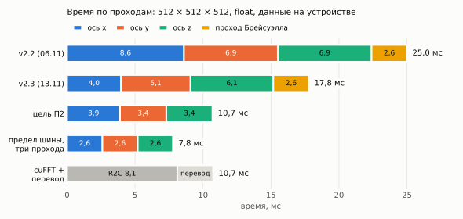
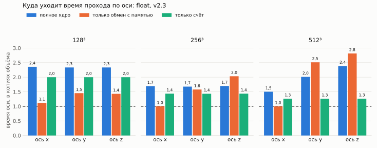

# R-4: ревью и план — как обойти cuFFT

Состояние на 2026-11-13, после v2.3. Машина — десктоп (RTX 3060 Ti, sm_86). Все времена — медианы `bench_transform`, данные на устройстве, float, если не сказано иное.

Документ состоит из двух частей. Разделы 1–4 — ревью: что доказано, чего стоит каждая цифра и где в работе были ошибки. Разделы 5–9 — план: порядок шагов, критерии приёмки и правила остановки. План рассчитан на исполнение моделью слабее той, что его писала, поэтому решения в нём приняты заранее, а там, где решение зависит от замера, записано правило выбора.

## 0. Как идти по плану

1. Один шаг — одна сессия — один коммит. Шаги выполняются в порядке номеров. Пропускать шаг или объединять два нельзя.
2. В начале сессии прочитать этот файл целиком, найти первый шаг без отметки `[x]` и делать только его.
3. Любая цифра в отчёте берётся из файла, созданного `scripts/r4_measure.sh` в этой же сессии. Вывод консоли, цифры из памяти и из прошлых сессий результатом не считаются.
4. Вердикт «быстрее / медленнее / в пределах шума» выносит `tools/r4_compare.py`, а не исполнитель.
5. Гипотеза записывается как гипотеза. Фраза «причина в X» допустима только после замера, в котором X менялся, а остальное — нет.
6. После шага: отметить `[x]` здесь с датой и одной строкой результата, добавить строку в «Журнал» `docs/BACKLOG.md`, обновить таблицу в `docs/benchmarks.md`, если изменилось время.
7. При срабатывании правила остановки (раздел 8) работа прекращается, пишется «пакет для разбора», решение принимает автор.

## 1. Где находимся



*Время полного трёхмерного преобразования Хартли по версиям факторизованного пути. Штриховая линия — cuFFT с переводом спектра в представление Хартли (перевод «по парам», шаг 0.3), пунктирная — три прохода по объёму со скоростью простой копии (2,6 мс на проход).*

| | 128 × 128 × 128 | 256 × 256 × 256 | 512 × 512 × 512 |
|---|---:|---:|---:|
| cuFFT R2C, без перевода | 0,133 мс | 1,01 мс | 8,11 мс |
| cuFFT + перевод в Хартли | 0,176 мс | 1,34 мс | 10,74 мс |
| RapiDHT v2.3 | 0,334 мс | 2,00 мс | 18,0 мс |
| отставание от cuFFT + перевод | 1,90 раза | 1,49 раза | 1,68 раза |
| RapiDHT v2.3 без прохода Брейсуэлла (сепарабельное) | 0,292 мс | 1,69 мс | 15,4 мс |
| дополнительная память устройства, 512 × 512 × 512 | | | 32 МиБ против 1 028 МиБ (спектр 514 + рабочая область 514) |

Цифры cuFFT — шаг 0.3 (`…_r4_cufft_pairs.json`). До него эталон переводил спектр в 1,5 раза медленнее и стоил 12,0 мс; отставание 1,50 раза, которое называлось раньше, было измерено против ослабленного эталона.

По времени библиотека проигрывает cuFFT на всех размерах, по памяти выигрывает в 32 раза. За неделю время на большом объёме сокращено с 44,2 мс (матричный путь) до 18,0 мс.

Мера, в которой удобно сравнивать: время простой копии объёма («пол прохода») — 2,6 мс на 512 × 512 × 512, 0,33 мс на 256³, 0,041 мс на 128³. cuFFT R2C стоит 3,1–3,2 пола на всех трёх размерах, то есть три прохода почти со скоростью копии; его перевод в Хартли — ровно один пол. У нас четыре прохода: Брейсуэлл уже идёт ровно за один пол, оси — за 1,5 (x), 2,0 (y) и 2,3 (z) пола на 512³, за 1,7 пола на 256³ и за 2,4 пола на 128³.

## 2. Что считать победой

| | Критерий | Состояние |
|---|---|---|
| П1 | Память: дополнительная память устройства не больше 1/10 от cuFFT | выполнен: 32 МиБ против 1 028 МиБ на 512³; на 1024³ RapiDHT работает (198 мс, те же 32 МиБ), а cuFFT на карте 8 ГБ не помещается (шаг 0.5) |
| П2 | Время задачи «преобразование Хартли» не больше, чем у «cuFFT + перевод», на 512³ (≤ 10,7 мс), 256³ (≤ 1,34 мс) и 128³ (≤ 0,176 мс) | не выполнен: 1,68 / 1,49 / 1,90 |
| П2+ | То же, не больше 0,9 от cuFFT на 512³ (≤ 9,7 мс) | не выполнен |
| П3 | Точность во float не хуже cuFFT более чем в 3 раза (наибольшая ошибка относительно СКЗ спектра) | не выполнен на 512³: 3,28 раза (256³ — 0,79); СКЗ ошибки лучше cuFFT на обоих размерах. Задача R-4a |
| П4 | Время не больше «голого» cuFFT R2C без перевода (8,11 мс на 512³) | не выполнен: 2,2 раза; практически недостижим (см. ниже) |

Главная цель плана — П2 при сохранении П1 и П3; П2+ — если П2 достигнут с запасом. П4 измеряется и честно публикуется, но целью не ставится.

Изменение критерия после шага 0.3: прежде П2 требовал 0,9 от ослабленного эталона (≤ 10,8 мс), теперь — паритета с усиленным (≤ 10,7 мс). Цель в миллисекундах почти не изменилась; изменилось то, что паритет теперь честный.



*Время по проходам. В строке цели проход Брейсуэлла выполняется внутри прохода по оси x, поэтому отдельного сегмента нет.*

Бюджет цели П2 на 512³: проход по x вместе с Брейсуэллом — не больше 3,9 мс, по y и по z — не больше 3,4 мс каждый, то есть около 1,3–1,5 пола на проход. Сейчас (шаг 0.2): 3,97 + 2,62, 5,11 и 6,09.

Почему три прохода — нижняя граница. Блок потоков на sm_86 получает не больше 99 КБ общей памяти, это около 24 тысяч чисел float. Слой 512 × 512 в неё не помещается, поэтому две оси за один проход по памяти не обработать; совмещение шагов разных осей (шаг 1 одной оси с шагом 2 другой) даёт те же три прохода. Три прохода со скоростью копии — 7,8 мс. cuFFT R2C без перевода занимает 8,11 мс, то есть уже идёт почти со скоростью копии (1,04 пола на проход). Чтобы выполнить П4, наши проходы должны были бы стать такими же — при вдвое большей арифметике на элемент (у Хартли нет экономии половины спектра, которую даёт R2C). Отсюда оценка П4.

Честная оценка шансов (пересмотрена после шага 0.3). Убрать отдельный проход Брейсуэлла (этап 3) — почти наверняка, около 2 мс; этап 2 — ещё 1–2 мс по оценке. Остаётся 14–15 мс, и до паритета нужно снять с трёх осей ещё 3,5–4,5 мс, то есть довести каждую до 1,3–1,5 пола. Это работа этапа 4, и откуда возьмётся выигрыш, покажет этап 1. Паритет на 512³ возможен, но не гарантирован; П2+ маловероятен. На 128³ задача отдельная: эталон 0,176 мс — это 59 мкс на проход при 41 мкс копии, и здесь заметна даже цена запуска ядра.

## 3. Ревью: что доказано

1. **Разложение N = N₁·N₂ работает и проверено против определения.** Тела ядер компилируются для CPU и сверяются с прямой суммой O(N²) во float и double на некубических размерах; на GPU путь сверен с CPU в double до 128 × 128 × 128.
2. **Память.** Преобразование на месте, таблицы — несколько КиБ. 32 МиБ в замере — гранулярность пула CUDA.
3. **Double упёрся в железо.** 150 мс на 512³ — это 0,26 TFLOP/с при пике FP64 карты около 0,25 (1/64 от 16,2). Настраивать double на этой карте бессмысленно; в плане его нет.
4. **Проход Брейсуэлла идёт со скоростью копии** на всех трёх размерах (0,041 / 0,32 / 2,6 мс). Ускорить его нельзя, можно только убрать.
5. **В двумерном случае GPU теперь быстрее CPU**: 1024 × 1024 — 0,29 мс против 1,30 мс. Вывод «на GPU стоит выносить только 3D» в `docs/benchmarks.md` относится к матричному пути и для факторизованного устарел.
6. **Раскладка общей памяти v2.3 по модели банков чистая.** Статическая проверка адресов (n = 512, 8 линий, 256 потоков): все виды обращений, кроме одного, дают неизбежный минимум слов на банк. Исключение — чтение коэффициентов шага 2 в варпах, куда попадает столбец k₁ = N₁/2: два адреса на банк вместо одного, в половине варпов. Это модель из документации (банк отдаёт 32 бита за такт), а не замер.

## 4. Ревью: ошибки и пробелы

Замечания упорядочены по тому, насколько они подрывают доверие к цифрам.

**З1. Конфигурация, по которой публикуются цифры, не была проверена на устройстве.** До 2026-11-13 тесты GPU доходили до конвейерного ядра во float только на размерах, где на блок приходится одна пачка линий (наибольшая ось 64), а длинные оси проверялись только в double. Эмуляция на CPU однопоточная и гонок не видит. Результат 18,0 мс получен ядром, выход которого на 512³ во float ни с чем не сверялся. Исправление — тесты `FactoredFloatAgreesWithCpuOnLongAxes_GPU` и `…OnBenchmarkExtents_GPU` (добавлены вместе с этим планом, на десктопе ещё не запускались): шаг 0.1.

**З2. В v2.3 одновременно изменены три вещи**: конвейер с подкачкой, раскладка против конфликтов банков и перенос четвёрками, который сократил число целочисленных делений в 2–3 раза. Какая из них дала 7,4 мс, неизвестно. Объяснение в журнале («конвейер прячет загрузку за вычислениями») — гипотеза.

**З3. Причина медленных осей y и z не установлена.** В `docs/benchmarks.md` она была записана как факт («полоски по 32 байта»). По документации NVIDIA обращения варпа к глобальной памяти и так объединяются в транзакции по 32 байта, так что число транзакций на байт у осей y, z и x одинаково. Остаются локальность по строкам, частичная запись строк кэша, TLB (у оси z строки пачки разнесены на 1 МиБ) — всё это предположения. Формулировка в `benchmarks.md` исправлена.

**З4. Эталон cuFFT не разложен на части и, возможно, ослаблен.** Замер «cuFFT» — это R2C плюс проход перевода, который читает каждый элемент спектра дважды (для x и для зеркального индекса). Неизвестно, сколько стоит R2C отдельно; возможно, перевод можно сделать на миллисекунду быстрее. Побеждать нужно сильнейший вариант эталона. Память эталона (1 028 МиБ) измерена для R2C «не на месте»; вариант «на месте» не пробовался. Шаг 0.3.

**З5. Точность во float не сравнивалась.** Ошибка факторизованного пути растёт с объёмом: 1,1·10⁻⁵ от СКЗ спектра на 256³ и 6,3·10⁻⁵ на 512³ (те же ядра, собранные для CPU, float против double, шумовой сигнал). Для cuFFT такой цифры нет. Шаг 0.4.

**З6. Ошибки процесса 13 ноября.** (а) «Замер v2.3» был снят бинарниками недельной давности: код из прошлого чата не попал в репозиторий, сборка не запускалась. (б) Контрольный прогон в 19:42 оказался на 5–8 % медленнее из-за фоновой нагрузки на GPU, при этом cuFFT в том же прогоне сдвинулся меньше чем на 2 %: шум действует на пути по-разному. (в) Запись в `BACKLOG.md` о результатах v2.3 не дошла до диска и была восстановлена только при этом ревью. От (а) и (б) защищает `scripts/r4_measure.sh`.

**З7. Дыры в экспериментальной базе.** `2026-11-06_evgeny_factored_v2.1.json` обрезан (прогон упал) — пользоваться им нельзя; эффект v2.1 отдельно не измерен. Разбивка по ядрам есть только для 512³. cuFFT измерен только во float и только в 3D. На v2.3 не измерены double и 2D. Объём 1024³ не пробовался, хотя это прямое следствие П1.

**З8. Код.** (а) В ядре на каждую пачку около 9 тысяч целочисленных делений с делителем, не известным при компиляции (на 197 тысяч умножений-сложений) — при том что все размеры степени двойки. (б) На коротких осях ширина пачки не растёт: при n = 128 в шаге 1 занята четверть потоков блока. (в) Параметры запуска (занятость, атрибуты функции) запрашиваются у драйвера при каждом вызове каждой оси — заметно на малых объёмах. (г) Шаги 1–2 продублированы в ядрах v2 и v2.3; v2 нужен только как точка сравнения. (д) Таблицы поворота читаются из глобальной памяти, остальные — из общей.

### Модель затрат на одну пачку (оценка, не замер)

512 × 8 чисел, 256 потоков, два блока на SM, 38 SM:

| Ресурс | Нужно на пачку | Замечание |
|---|---:|---|
| Умножения-сложения | 196 608 | 6 144 инструкции варпа |
| Целочисленные деления | 8 960 | по 10–20 инструкций каждое — сравнимо со всей арифметикой |
| Обмен с общей памятью | ≈ 400 КиБ | при 128 байтах за такт — около 3 000 тактов |
| Глобальная память | 32 КиБ | 16 чтение + 16 запись |
| Варпы на SM | 16 из 48 | занятость 33 %, ограничена общей памятью (39 КиБ на блок) |

При времени оси 4,1 мс SM тратит на пачку около 4,7 мкс; предел шины — 3,0 мкс. Арифметике и общей памяти при идеальном совмещении хватило бы 1,5–2 мкс. Вывод модели: в пределе шины вычисления помещаются, потери — в несовмещении (семь барьеров `__syncthreads` на пачку, мало варпов) и в служебных инструкциях. Проверяется этапом 1.

## 5. Протокол эксперимента

Одно измерение:

```bash
bash scripts/r4_measure.sh <метка> [RAPIDHT_...=значение ...]
```

Скрипт пересобирает `build-cuda` и `build-bench`, прогоняет тесты `Factored*`, записывает состояние кода и GPU в `.meta.txt`, затем снимает бенчмарк (7 повторов) и разбивку по ядрам на трёх размерах. Существующий результат не перезаписывает.

Сравнение:

```bash
python3 tools/r4_compare.py <база>.json <новое>.json --trace <база>_trace.txt <новое>_trace.txt
```

Правила:

1. **Схема А–Б.** Перед правкой — замер `<шаг>_a`, после — `<шаг>_b`, в одной сессии, не трогая машину между ними. Если выигрыш меньше двух порогов шума — третий замер `<шаг>_a2` на коде до правки (`git stash`, замер, `git stash pop`); `a` и `a2` должны совпасть в пределах шума.
2. **Порог.** Изменение считается результатом, если оно не меньше 3 % и не меньше трёх коэффициентов вариации. При вариации выше 2 % замер повторяется (закрыть Mattermost и удалённый рабочий стол).
3. **Одна правка — один замер.** Если шаг требует двух независимых изменений, это два шага.
4. **Переключатель.** Где возможно, старое и новое поведение живут в одной сборке под переменной `RAPIDHT_R4_<ИМЯ>` (читается один раз, как `RAPIDHT_FACTORED_KERNEL`). После приёмки переключатель удаляется в том же коммите; после отказа удаляется код.
5. **Проверка раньше скорости.** Новое или изменённое ядро сначала проходит эмуляцию на CPU против прямой суммы (`tests/test_factored_kernels.cpp`, float и double, некубические размеры), затем тесты GPU, и только потом измеряется. Весь код устройства R-4 живёт в `src/internal/factored_kernels.cuh`.
6. **Приёмка** — по трём размерам сразу: выигрыш на целевом размере шага и отсутствие вердикта «МЕДЛЕННЕЕ» на двух других.
7. **Запись отказа.** Отвергнутый эксперимент записывается в журнал с цифрами так же, как принятый.

## 6. План

### Этап 0. Доверие к цифрам

Ядра не меняются. Пока этап не закрыт, ускорением заниматься нельзя.

- [x] **0.1. Проверить v2.3 на устройстве.** (2026-11-13) Все 15 тестов `Factored*` зелёные, включая оба новых: длинные оси — 0,18 с, 256³ и 512³ — 2,2 с. Зарегистрировано 94 теста. Публикуемая конфигурация v2.3 во float совпадает с CPU в пределах 5·10⁻⁴ СКЗ спектра.
  `cmake --build --preset cuda -j && ctest --preset cuda --output-on-failure`. Ожидается 94 теста, 2 пропуска.
  Принять: оба новых теста `FactoredFloat…_GPU` зелёные.
  Если красные — правило остановки С1. Для локализации допустим один запуск с `RAPIDHT_FACTORED_KERNEL=v2`; исправлять ядро наугад нельзя.
- [x] **0.2. Базовый замер.** (2026-11-13, `…_r4_base.*`) 512³ — 18,0 мс, cuFFT — 12,0; 256³ — 2,00 / 1,49; 128³ — 0,334 / 0,192. Вариация ≤ 1,3 %, с замером v2.3 совпадает в пределах шума на всех девяти строках. По ядрам (медиана 11 вызовов): 512³ — x 3,97, y 5,11, z 6,09, Брейсуэлл 2,62 мс; 256³ — все оси 0,55–0,56, Брейсуэлл 0,33; 128³ — все оси 0,097, Брейсуэлл 0,042. **Разница между осями есть только на 512³**: на 256³ и 128³ оси равны. Ось z на 512³ разбросана сильнее остальных (5,6–6,3 мс между вызовами при 5,07–5,20 у y). Первый вызов каждого размера холодный (x 0,53 мс на 128³ против 0,097) — медиана его отбрасывает. Исправлено в `r4_compare.py`: трассы старого формата (без `n=…`) теперь сопоставляются по размеру из строки сводки.
  **Следствие для этапа 1 (гипотеза, не вывод):** раз на 256³ оси равны, а на 512³ нет, причина медленных y и z растёт с шагом между строками пачки (2 КиБ и 1 МиБ на 512³ против 1 КиБ и 256 КиБ на 256³) — кандидаты: TLB, раскладка по каналам памяти, кэш L2 (4 МиБ). Проверяется в 1.1–1.2. `bash scripts/r4_measure.sh base`. Скрипт запускается впервые: ошибки в самом скрипте исправить и отметить в журнале.
  Принять: вариация всех строк ≤ 2 %, 512³ в пределах 3 % от 18,0 мс, cuFFT — от 12,0 мс.
- [x] **0.3. Разложить эталон cuFFT.** (2026-11-13, `…_r4_cufft_rows.*`, `…_r4_cufft_pairs.*`) R2C без перевода: 8,11 / 1,008 / 0,133 мс (512³ / 256³ / 128³). Старый перевод (по выходам, каждый коэффициент читается дважды) стоил 3,87 мс на 512³; новый `SpectrumToHartley` (по хранимым коэффициентам, один раз) — 2,62 мс, ровно один пол. Эталон «cuFFT + перевод» стал быстрее на 10,4 / 10,2 / 8,9 %: **10,74 / 1,34 / 0,176 мс**; остальные строки замера в пределах шума. По правилу шага оставлен только новый перевод, старое ядро и `RAPIDHT_R4_CUFFT_CONVERT` удалены; новое ядро сверено с определением на CPU. Память cuFFT: спектр 514 МиБ + рабочая область 514 МиБ на 512³ (129 МиБ = 64,5 + 64,5 на 256³). R2C «на месте» не измерялся: он требует строк, дополненных до 2(W/2 + 1) чисел, которых в раскладке библиотеки нет. Разделы 1–2 и контрольная точка пересчитаны от новой планки.
  Исходная постановка шага:
  В `benchmarks/cufft_baseline.{h,cu}` добавить метод без прохода перевода и бенчмарк `cuFFT_R2C/f32/3D/…` (скрипт и `r4_compare.py` это имя уже знают). Если перевод (разность двух замеров) на 512³ дороже 3,0 мс — переписать его так, чтобы каждый элемент спектра читался один раз и давал два выхода, H(k) = Re − Im и H(−k) = Re + Im, и сделать этот вариант замером `cuFFT`. Отдельно записать объём рабочей области из `cufftGetSize3d` и, если получится за одну сессию, память варианта R2C «на месте».
  Принять: в `docs/benchmarks.md` есть обе планки (с переводом и без) и память эталона; цель П2 пересчитана от новой планки.
- [x] **0.4. Точность.** (2026-11-13, `…_r4_accuracy.txt`, программа `benchmarks/accuracy_gpu3d.cpp`) Ошибка во float относительно СКЗ спектра, эталон — CPU в double:

  | | 256³, наибольшая | 256³, СКЗ | 512³, наибольшая | 512³, СКЗ |
  |---|---:|---:|---:|---:|
  | cuFFT + перевод | 1,41·10⁻⁵ | 2,76·10⁻⁷ | 1,92·10⁻⁵ | 3,17·10⁻⁷ |
  | RapiDHT, факторизованный | 1,12·10⁻⁵ (0,79 от cuFFT) | 2,02·10⁻⁷ | **6,31·10⁻⁵ (3,28 от cuFFT)** | 2,39·10⁻⁷ |
  | RapiDHT, матрицы | 3,16·10⁻⁴ | 4,18·10⁻⁵ | 7,36·10⁻⁴ | 8,42·10⁻⁵ |

  Среднеквадратичная ошибка факторизованного пути меньше, чем у cuFFT, на обоих размерах (в 0,73 и 0,75 раза). Наибольшая на 256³ тоже меньше, а на 512³ — в 3,28 раза больше: **П3 по букве не выполнен**. При СКЗ ошибки ниже, чем у cuFFT, это похоже на небольшую группу плохих коэффициентов, а не на общую потерю точности; это предположение. Наибольшие ошибки на GPU совпали с эмуляцией ядер на CPU до трёх знаков (1,12·10⁻⁵ и 6,31·10⁻⁵) — ещё одно подтверждение, что устройство считает то же, что эмуляция. По правилу шага план не останавливается; заведена задача R-4a в `docs/BACKLOG.md`. Матричный путь на 1–1,5 порядка хуже обоих — к R-4 не относится, записано в `benchmarks.md`.
  Исходная постановка шага: В тест или в `profile_gpu3d` добавить вывод наибольшей ошибки относительно СКЗ спектра (шумовой сигнал `MakeNoise`, эталон — CPU в double) для факторизованного пути и для cuFFT с переводом на 256³ и 512³.
  Принять: две цифры в `docs/benchmarks.md`. Если отношение больше 3 — завести в бэклоге задачу о порядке суммирования; план не останавливается.
- [x] **0.5. Объём 1024 × 1024 × 1024 во float (4 ГиБ).** (2026-11-13, `…_r4_1024.txt`) **RapiDHT помещается, cuFFT — нет.** Факторизованный путь: 198 мс на преобразование (медиана трёх: 197,4–199,7 мс), сверх объёма держит те же 32 МиБ. cuFFT: при 7 062 МиБ свободных до начала `cufftPlan3d` вернул код 5 (`CUFFT_INTERNAL_ERROR`, не `CUFFT_ALLOC_FAILED`; почему именно он — неизвестно). Независимо от кода ошибки, cuFFT на 1024³ не помещается по арифметике: после объёма (4 096 МиБ) остаётся около 2 970 МиБ, а один только половинный спектр — 4 104 МиБ; с рабочей областью нужно около 12 ГиБ. (Моя оценка «около 8,2 ГиБ» в постановке была ошибочной: половинный спектр комплексный и занимает столько же, сколько объём, а не половину.) Контроль на 512³ той же программой: cuFFT помещается, 10,72 мс — совпадает с бенчмарком. Вариант cuFFT с минимальной рабочей областью не пробовался, но и он не уложится: спектр больше свободной памяти. Наибольший кубический объём на карте 8 ГБ во float: **RapiDHT — 1024³, cuFFT — 512³** (размеры между ними библиотека не поддерживает).
  Попутно: на 1024³ оси идут хуже, чем на 512³ — 50,9 / 58,6 / 66,4 мс при пороге копии 21,3 мс (Брейсуэлл), то есть 2,4 / 2,8 / 3,1 пола против 1,5 / 2,0 / 2,3 на 512³. Возможная причина (расчёт, не замер): при n = 1024 блок занимает 77 КиБ общей памяти, на SM помещается один блок — 8 варпов вместо 16 на 512³. Это вход для шагов 2.4 и 4Б.
  Исходная постановка шага:
  Тест на согласие с CPU на длинной оси уже есть (`{1024, 32, 16}`). Измерить `profile_gpu3d 1024 3 f32 factored` (нужно около 4,3 ГиБ свободной видеопамяти и 8 ГиБ ОЗУ) и попытку построить план cuFFT того же размера; сохранить текст ошибки выделения памяти.
  Принять: в `docs/benchmarks.md` строка «наибольший кубический объём на карте 8 ГиБ» для обоих путей.
- [x] **0.6. Привести базу в порядок.** (2026-11-13, `…_r4_f64_2d.json`) В `docs/benchmarks.md`: обрезанный JSON v2.1 помечен непригодным; вывод «на GPU стоит выносить только 3D» ограничен матричным путём; таблица по ядрам расширена на 128³, 256³ и 1024³. Прогон v2.3 (3 повтора, вариация ≤ 1,3 %) против v2 от 06.11:
  - **f32 2D — быстрее**: 128² 17,2 → 15,0 мкс (−13 %), 512² 45,9 → 30,2 (−34 %), 1024² 293 → 156 (−47 %). Против CPU во float (18,3 / 285 / 1 321 мкс) — в 1,2 / 9,4 / 8,5 раза быстрее.
  - **f64 3D — медленнее (регрессия v2.3)**: 128³ 1,52 → 2,09 мс (+38 %), 256³ 13,6 → 16,3 (+20 %), 512³ 150 → 164 (+9 %). Сравнение двух разных дней, а не А–Б в одной сборке; но разница далеко за порогом шума. Причина не установлена (кандидаты: 8 четвёрок double в регистрах на поток, при 4 линиях — одна четвёрка на позицию). Заведён шаг 2.0.
  **Этап 0 закрыт.**
  Исходная постановка шага: В `docs/benchmarks.md`: пометить обрезанный JSON v2.1 как непригодный; исправить вывод про 2D; добавить разбивку по ядрам на 128³ и 256³ из шага 0.2; разовые замеры v2.3 для double 3D и float 2D (полный прогон `bench_transform --benchmark_filter='Factored'`).

### Этап 1. Диагностика: куда уходит время оси

Ничего не ускоряет. Даёт числа, по которым выбирается порядок этапа 4.

- [x] **1.1. Три режима ядра.** (2026-11-13, `…_r4_s11_{full,io,compute}.*`) `FactoredAxisKernelPipelined` получил аргумент `ablate` из `RAPIDHT_R4_ABLATE` (`io` | `compute`). Режим `io` — подкачка и запись как обычно, счёт пропущен; проход — тождество, это проверяет тест эмуляции `PipelinedIoModeIsIdentity_{Float,Double}` (испорченный режим тест ловит). Режим `compute` — первая пачка грузится один раз, дальше только счёт; пишется лишь результат первой пачки блока, чтобы компилятор не выбросил арифметику. Обычный режим от лишнего аргумента не замедлился: `s11_full` против `cufft_pairs` — в пределах шума на всех 12 строках.

  

  *Время прохода по оси в копиях объёма (копия — проход Брейсуэлла: 0,042 / 0,331 / 2,617 мс). Штриховая линия — одна копия. Медиана 10 вызовов после первого.*

  | мс | ось x | ось y | ось z |
  |---|---:|---:|---:|
  | полное ядро, 512³ | 3,93 | 5,26 | 6,23 |
  | только обмен (`io`), 512³ | 2,61 | 6,57 | 7,36 |
  | только счёт (`compute`), 512³ | 3,30 | 3,30 | 3,30 |
  | полное / обмен / счёт, 256³ | 0,560 / 0,331 / 0,475 | 0,555 / 0,522 / 0,474 | 0,562 / 0,673 / 0,475 |
  | полное / обмен / счёт, 128³ | 0,099 / 0,047 / 0,084 | 0,098 / 0,061 / 0,084 | 0,098 / 0,060 / 0,084 |

  Что показал замер (это уже измерено, а не предположено):
  1. **Обмен с памятью по оси x идёт ровно со скоростью копии** (1,00 копии на 256³ и 512³). По осям y и z он в 1,4–2,8 раза медленнее, и разрыв растёт с размером: 2,5 и 2,8 копии на 512³. **Медленные y и z — это доступ к памяти**, а не арифметика: счёт на всех трёх осях одинаков до третьего знака.
  2. **Совмещение работает:** полное ядро занимает 0,49–0,75 от суммы «обмен + счёт».
  3. **На осях y и z полное ядро быстрее, чем один только обмен** (512³: 5,26 против 6,57 мс по y). Счёт, вставленный между обращениями к памяти, разреживает их — видимо, одновременные «полосатые» запросы всех блоков мешают друг другу (гипотеза).
  4. **Счёт сам по себе стоит 1,26 копии на 512³, 1,44 на 256³ и 2,0 на 128³.** Это нижняя граница оси при идеальном совмещении. Бюджет П2 — 1,3–1,5 копии на ось, так что счёт тоже придётся ускорять, особенно на малых размерах.

  Предварительно по правилам 1.3: Д1 не сработало (совмещение есть), Д2 сработало для оси x на 512³ и 256³ и для всех осей на 128³, Д3 сработало сильно (обмен y − обмен x = 3,96 мс), Д4 не сработало (обмен x — 2,61 мс). Окончательный вывод — после 1.2.
  Исходная постановка шага: В `FactoredAxisKernelPipelined` добавить целый аргумент `ablate`, значение — из `RAPIDHT_R4_ABLATE`:
  `io` — после заполнения тайла шаги 1–2 и поворот пропускаются, тайл записывается обратно как есть;
  `compute` — регистры загружаются один раз до цикла, подкачки и записи в глобальную память нет, тайл каждый раз заполняется из тех же регистров.
  Результат в этих режимах неверен; тесты их не используют. Снять `r4_measure.sh` в трёх режимах и заполнить таблицу (мс, из трассы):

  | | ось x | ось y | ось z |
  |---|---:|---:|---:|
  | полное ядро, 512³ | | | |
  | только обмен (`io`) | | | |
  | только счёт (`compute`) | | | |
  | то же для 128³ | | | |

- [ ] **1.2. Счётчики.** Проверить `which ncu`. Если есть:
  `ncu --set full -k regex:FactoredAxisKernelPipelined -c 3 -o benchmarks/results/<дата>_r4_ncu build-bench/benchmarks/profile_gpu3d 512 1 f32 factored` (первые три запуска ядра — оси x, y, z). Выписать для каждой оси: регистров на поток, достигнутую занятость, долю занятых слотов выдачи инструкций, три главные причины простоя варпов, число конфликтов банков общей памяти, попадания L1 и L2, пропускную способность DRAM в процентах от пика, долю целочисленных инструкций. Точные имена метрик — `ncu --query-metrics`. Если `ncu` нет или не хватает прав — записать это в журнал и попросить автора установить; шаг 1.1 от этого не зависит.
  Независимо от `ncu`: число регистров ядра из вывода ptxas (`nvcc --help`, опция подробного вывода ptxas).
- [ ] **1.3. Вывод.** По таблице 1.1 записать в этот файл, какие правила сработали:

  | Правило | Условие (512³, по оси) | Что из него следует |
  |---|---|---|
  | Д1 | полное ≥ 0,85 × (обмен + счёт) | совмещения нет: приоритет 4Б, затем 4Г |
  | Д2 | счёт > обмен | ядро ограничено вычислениями: приоритет 4А, затем 4В |
  | Д3 | обмен(y) − обмен(x) > 0,5 мс | обмен осей y, z хуже сам по себе: шаг 2.4 обязателен, иначе пропускается |
  | Д4 | обмен(x) > 3,2 мс | даже чистый обмен далёк от пола: правило остановки С3 |

### Этап 2. Дешёвые улучшения ядра

Обязательны, выполняются в этом порядке, каждое — отдельным шагом по схеме А–Б.

- [ ] **2.0. Регрессия v2.3 в double.** Сначала А–Б в одной сборке: `r4_measure.sh` меряет только float, поэтому для double — `bench_transform --benchmark_filter='^FactoredResident/f64/3D/'` (3 повтора) без переменной и с `RAPIDHT_FACTORED_KERNEL=v2`, сравнение `r4_compare.py`. Если v2 «быстрее» хотя бы на одном размере — в `FactoredAxis` направлять double на ядро v2 (`FactoredAxisKernelFast`) всегда, без переменной; тогда в шаге 5.1 ядро v2 не удаляется, а остаётся путём для double. Если в пределах шума — записать, что 06.11 и 13.11 несравнимы, и ничего не менять. Причину регрессии не искать: double не цель (раздел 7).
  Принять: f64 3D не медленнее v2 ни на одном размере; f32 без изменений (`r4_measure.sh` — в пределах шума).

- [ ] **2.1. Индексная арифметика без деления.** Все `/` и `%` на `n`, `n1`, `n2`, `lanes`, `quadsPerRow`, `laneGroups` в `PipelineLoad`, шагах 1–2, `FactoredTwiddle` и пересборке заменить сдвигами и масками; логарифмы посчитать один раз в начале ядра. Формулы не меняются — эмуляция на CPU обязана дать те же числа.
  Основание: раздел 11.1.1 Best Practices Guide (деление и остаток дороги; для степеней двойки — сдвиг и маска; компилятор делает замену сам, только если делитель — литерал). Текст раздела при составлении плана не перечитывался — сверить перед шагом.
  Принять: вердикт «быстрее» на 512³. Ожидание (оценка): 5–15 % на ось.
- [ ] **2.2. Ширина пачки по длине оси.** Сейчас float всегда берёт 8 линий. Выбирать наибольшую степень двойки `lanes`, при которой n·lanes ≤ 4096, пачка помещается по длине и по памяти, а `quadsPerThread ≤ kFactoredMaxQuads`: 128 → 32 линии, 256 → 16, 512 → 8 (без изменений). В эмуляции добавить формы с 16 и 32 линиями.
  Принять: 128³ быстрее не менее чем на 8 %, 512³ в пределах шума.
- [ ] **2.3. План запуска один раз.** Перенести вычисление `lanes`, размера общей памяти, сетки и вызов `cudaFuncSetAttribute` из `FactoredAxis` в инициализацию (структура на ось в `CudaBackend`), в вызове оставить только запуск ядра.
  Принять: 128³ быстрее не менее чем на 3 %; иначе оставить как упрощение кода, если шум, и откатить, если медленнее.
- [ ] **2.4. Широкая пачка на длинной оси (только если сработало Д3).** Под `RAPIDHT_R4_LANES=16`: для n = 512 — 16 линий и 512 потоков в блоке (74 КиБ общей памяти, один блок на SM). Смотреть время по осям отдельно.
  Принять для тех осей, где трасса показывает не менее 5 %; выбор ширины тогда делается по оси.

### Этап 3. Три прохода вместо четырёх

Самый надёжный выигрыш плана: проход Брейсуэлла стоит 2,6 мс и не ускоряется.

Идея. Порядок осей свободен. Если последней идёт ось x (линии лежат в памяти подряд), то блоку для комбинации Брейсуэлла нужны четыре линии: (y, z), (−y, z), (y, −z), (−y, −z); зеркало по x лежит внутри самой линии. Формула — та, что уже записана в `BracewellInPlace3DKernel` (там строки `r00, r10, r01, r11` — как раз эти четыре линии). Пачка последнего прохода — это орбиты пар (y, z), а не соседние линии.

- [ ] **3.1. Порядок осей z, y, x** в `Backend::RunFactored`. Математика не меняется.
  Принять: нет вердикта «МЕДЛЕННЕЕ» ни на одном размере.
- [ ] **3.2. Эталон на CPU.** В `src/factored.cpp` — функция «преобразование по x для группы зеркальных линий плюс комбинация Брейсуэлла»; тест в `tests/test_factored.cpp` против прямого трёхмерного определения, включая размеры, где орбита вырождается (y = 0, y = H/2, z = 0, z = D/2, а также H = 2 и D = 1 для двумерного случая: там группа — пара (y, −y)).
  Принять: тесты зелёные на CPU во float и double.
- [ ] **3.3. Ядро последнего прохода.** Новое ядро на основе конвейерного. Требования, без которых результат неверен:
  каждая линия принадлежит ровно одной пачке (перечислять орбиты: y от 0 до H/2, z от 0 до D/2), иначе преобразование по x применится к ней дважды;
  в вырожденной орбите одна и та же линия загружается в несколько мест тайла и записывается несколько раз одинаковыми значениями — это допустимо;
  число орбит в ряду нечётное (H/2 + 1), последняя пачка ряда неполная — нужна маска;
  комбинация читает все восемь значений до записи любого из них.
  Сепарабельное преобразование (`Modes` без Брейсуэлла) продолжает использовать обычное ядро. Отдельный вызов `kernels::BracewellInPlace` для факторизованного пути убирается, для матричного остаётся.
  Принять: эмуляция и тесты GPU зелёные; 512³ быстрее не менее чем на 1,8 мс, 256³ и 128³ — «быстрее».
  Если за две сессии тесты не зелёные — правило остановки С4.

### Контрольная точка после этапа 3

Снять `r4_measure.sh stage3`, обновить оба рисунка и таблицу раздела 1.

| 512³ | Действие |
|---|---|
| ≤ 10,7 мс | П2 на 512³ выполнен: проверить 256³ и 128³; если и там — этап 5, иначе этап 4 для малых размеров |
| 10,7–15,5 мс | этап 4 в порядке, заданном правилами Д1–Д3 |
| > 15,5 мс | правило остановки С3: этапы 2 и 3 вместе дали меньше 2,5 мс |

### Этап 4. Перестройка ядра оси (условный)

Не больше двух шагов из этого этапа без разбора с автором. Порядок задают правила шага 1.3; если не сработало ни одно — 4А, затем 4Б.

- [ ] **4А. Поворот внутри шага 1.** Сгруппировать частоты потока зеркальными парами (k₁, N₁ − k₁), столбцы таблицы C1 в общей памяти переставить в том же порядке; поток применяет поворот к своим двум парам в регистрах и пишет уже повёрнутые значения. Отдельный проход `FactoredTwiddle`, два барьера и чтение таблиц из глобальной памяти исчезают.
  Принять: «быстрее» на 512³.
- [ ] **4Б. Шаги на месте через регистры.** Когда число элементов тайла равно 16 × число потоков, каждый поток держит весь свой результат шага в 16 регистрах: все считают, барьер, все пишут — рабочий буфер не нужен, общая память блока падает с 39 до 22 КиБ. Освободившееся потратить на одно из двух и измерить оба варианта: четыре блока на SM (32 варпа из 48) или вдвое более широкая пачка. Регистров на поток должно остаться не больше 64.
  Принять: «быстрее» на 512³ хотя бы в одном варианте.
- [ ] **4В. Тайл 8 частот × 4 линии.** Каждый элемент читается из общей памяти вдвое реже (N₁/8 раз вместо N₁/4). Требует 32 регистра под суммы и вдвое больше элементов на поток — делать после 4Б или вместе с пачкой в 16 линий.
  Принять: «быстрее» на 512³.
- [ ] **4Г. Асинхронная подкачка.** Заменить подкачку через регистры на `__pipeline_memcpy_async` в отдельный буфер общей памяти (два тайла, считаем в одном, грузим в другой). Нужна раскладка 4Б. В эмуляции функции конвейера заменяются на `memcpy`.
  Принять: «быстрее» на 512³; иначе откатить — регистровая подкачка проще.
- [ ] **4Д. Специализация по размерам при компиляции.** Шаблон ядра по (N₁, N₂, lanes) для 128, 256, 512, 1024: циклы разворачиваются, адресная арифметика становится константной.
  Делать только если шаг 2.1 дал больше 8 %: это признак, что служебные инструкции ещё значимы.

### Этап 5. Закрепление

- [ ] **5.1.** Удалить переключатель `RAPIDHT_FACTORED_KERNEL` и все `RAPIDHT_R4_*`; ядро v2 (`FactoredAxisKernelFast`) удалить, если шаг 2.0 не оставил его путём для double; обновить `docs/architecture.uxf`.
- [ ] **5.2.** Полная таблица в `docs/benchmarks.md` и `README.md`: 64³–1024³ и 512²–2048², время против обеих планок cuFFT, память, точность, наибольший объём. Рисунки — в `docs/images`, только SVG (`*.png` в `.gitignore`).
- [ ] **5.3.** Бенчмарк свёртки «туда — умножение — обратно» против R2C + C2R: это то, как преобразование используется на деле, и здесь Хартли не нужен второй буфер.
- [ ] **5.4.** Закрыть R-4 в `docs/BACKLOG.md` с вердиктом по П1–П4, каким бы он ни был.

## 7. Чего не делать

- Не считать преобразование Хартли через cuFFT: это снимает и новизну, и выигрыш по памяти.
- Не трогать double: он на пределе карты.
- Не браться за тензорные ядра, пока оси не дошли до 1,3 пола: сейчас узкое место не арифметика.
- Не менять публичный API, CPU-бэкенд и матричный путь GPU в рамках R-4.
- Не удалять файлы результатов и не перезаписывать их; непригодные помечаются в `docs/benchmarks.md`.
- Не запускать замеры при работающем обучении hno-porous.

## 8. Правила остановки

| | Условие | Что делать |
|---|---|---|
| С1 | Тест GPU красный при зелёной эмуляции на CPU | Это гонка или различие устройства и эмуляции. Ничего не править. Откатить правку шага, приложить вывод теста |
| С2 | Два шага подряд отвергнуты | Остановиться; если этап 1 не закрыт — закрыть его |
| С3 | После этапа 3 на 512³ больше 15,5 мс, или после двух шагов этапа 4 больше 13,0 мс, или сработало Д4 | Остановиться: нужна смена подхода, а не настройка |
| С4 | Шаг не закрыт за две сессии | Остановиться, не расширять шаг |
| С5 | Вариация выше 2 % после повторного замера | Остановиться: сначала найти источник шума |

Пакет для разбора: номер шага; что сделано (diff); файлы `.json`, `_trace.txt`, `.meta.txt` обоих замеров; вывод `r4_compare.py`; таблицы шагов 1.1 и 1.2; одна фраза — что ожидалось и что получилось.

## 9. Справка

Константы карты (RTX 3060 Ti, compute capability 8.6), по документации NVIDIA:

- общая память: 100 КБ на SM, до 99 КБ на блок; регистров 64 К на SM, до 255 на поток; до 48 варпов и 16 блоков на SM ([Ampere Tuning Guide](https://docs.nvidia.com/cuda/ampere-tuning-guide));
- банков общей памяти 32, каждый отдаёт 32 бита за такт; конфликтующие обращения выполняются последовательно; обращения варпа к глобальной памяти объединяются в транзакции по 32 байта ([CUDA C++ Best Practices Guide](https://docs.nvidia.com/cuda/archive/12.9.2/cuda-c-best-practices-guide/index.html), разделы 9.2.1 и 9.2.3; там же раздел 11.1.1 о делении);
- асинхронное копирование из глобальной памяти в общую доступно с compute capability 8.0, размеры 4, 8 и 16 байт, лучший результат при выравнивании на 128 байт ([Asynchronous Data Copies](https://docs.nvidia.com/cuda/cuda-programming-guide/04-special-topics/async-copies.html));
- разделы отчёта Nsight Compute и признаки узких мест ([Profiling Guide](https://docs.nvidia.com/nsight-compute/ProfilingGuide), [Compute Triage Guide](https://docs.nvidia.com/nsight-compute/ComputeTriage/index.html)).

Из `docs/benchmarks.md`: копия объёма 512³ float на этой машине — 2,6 мс (измерено); паспортные пик FP32 — 16,2 TFLOP/с и шина — 448 ГБ/с; FP64 — примерно в 64 раза медленнее FP32.

Файлы трека:

| Что | Где |
|---|---|
| Математика разложения, эталон на CPU | `src/internal/factored.h`, `src/factored.cpp` |
| Ядра устройства | `src/internal/factored_kernels.cuh` |
| Запуск ядер, выбор ширины пачки | `src/kernels.cu` (`FactoredAxis`) |
| Порядок проходов | `src/backend_cuda.cpp` (`RunFactored`) |
| Эмуляция ядер на CPU | `tests/test_factored_kernels.cpp` |
| Тесты GPU | `tests/test_correctness.cpp` (`Factored*`) |
| Эталон cuFFT | `benchmarks/cufft_baseline.cu` |
| Замер и сравнение | `scripts/r4_measure.sh`, `tools/r4_compare.py` |
| Результаты | `benchmarks/results/<дата>_<машина>_r4_<метка>.*` |

История версий и цифры до 13 ноября — раздел R-4 в `docs/BACKLOG.md` и `docs/benchmarks.md`.
