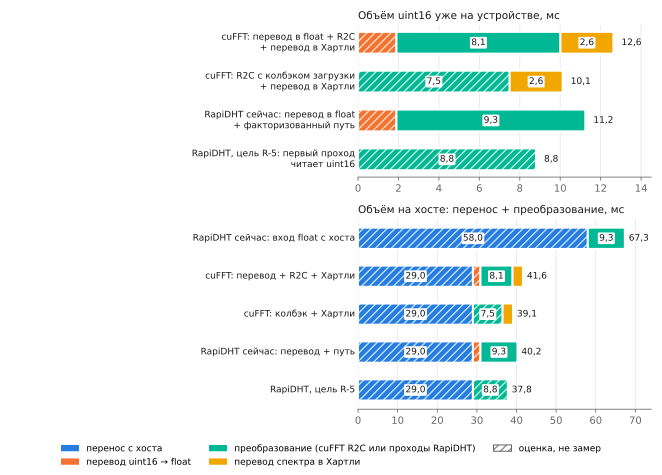

# R-5: целочисленные томограммы — постановка, ревью и план

Состояние на 2026-11-25: R-4 закрыт, первый замер R-5 (точность на целом входе) сделан. Машина — десктоп (RTX 3060 Ti, sm_86, CUDA 12.4). Все времена — медианы `bench_transform`, если не сказано иное. Оси названы по раскладке памяти, как в `docs/R4_PLAN.md`: x — самая быстрая (Width), z — самая медленная.

Документ состоит из трёх частей. Разделы 1–4 — постановка и ревью: зачем R-5, что известно, где риски. Разделы 5–9 — план: порядок шагов, критерии приёмки, правила остановки. Раздел 10 — что после R-5 ведёт к общей цели. План, как и план R-4, рассчитан на исполнение моделью слабее той, что его писала: решения приняты заранее, а там, где решение зависит от замера, записано правило выбора.

## 0. Как идти по плану

1. Один шаг — одна сессия — один коммит. Шаги выполняются в порядке номеров; пропускать и объединять нельзя. Условный шаг (помечен «условный») выполняется, только если его условие выполнено; иначе он помечается `[-]` с причиной.
2. В начале сессии прочитать этот файл целиком, найти первый шаг без отметки `[x]`/`[-]` и делать только его.
3. Шаг 0.0 — решения автора. Пока он не закрыт, действуют значения «по умолчанию» из его таблицы, и это записывается в отчёте шага.
4. Любая цифра времени берётся из файла, созданного `scripts/r5_measure.sh` в этой же сессии; цифра точности — из файла `accuracy_integer` этой же сессии. Вывод консоли, цифры из памяти и из прошлых сессий результатом не считаются.
5. Вердикт «быстрее / медленнее / в пределах шума» выносит `tools/r4_compare.py`, а не исполнитель.
6. Гипотеза записывается как гипотеза. «Причина в X» — только после замера, в котором менялся X и ничего больше.
7. После шага: отметить `[x]` здесь с датой и одной строкой результата, добавить строку в «Журнал» `docs/BACKLOG.md`, обновить таблицу в `docs/benchmarks.md`, если изменилась цифра.
8. При срабатывании правила остановки (раздел 8) работа прекращается, пишется «пакет для разбора», решение принимает автор.

## 1. Постановка

### Общая цель и место R-5

Цель библиотеки (формулировка автора): найти места для улучшения и получить библиотеку, наиболее эффективную по производительности для задач **спектрального анализа трёхмерных томограмм**.

Под задачами понимаются операции над томограммой, в основе которых лежит спектральное преобразование:

| | Задача | Пример в работах автора |
|---|---|---|
| Т1 | Спектр объёма | вход любой спектральной обработки |
| Т2 | Фильтрация свёрткой: сглаживание, полосовые фильтры | фильтрация перед сегментацией (диссертация, B-103, B-104) |
| Т3 | Спектр мощности, корреляционные функции (двухточечная S₂), взаимная корреляция для совмещения | характерные длины, представительный объём |
| Т4 | Банк фильтров: одно прямое преобразование, много окон | поля функционалов Минковского (B-202) |
| Т5 | Спектральные слои нейронных операторов | R-1, hno-porous |

Вход у всех задач один: томограмма в целых числах — **uint8 (0…255) или uint16 (0…65535)**, так её записывают все современные томографы. Объём обычно лежит на диске и в памяти хоста, а не на карте. R-5 закрывает именно этот вход и симметричный ему выход (томограмма → томограмма), а также вводит набор эталонных задач, по которым дальше меряется вся библиотека.

### Уточнение постановки (предложение; решение — шаг 0.0)

1. **Мерило — задача целиком, а не преобразование.** R-4 показал, почему: само преобразование быстрее cuFFT с переводом (0,88 раза на 512³), а свёртка — то, ради чего преобразование вызывают, — медленнее cuFFT R2C + C2R в 1,13–1,17 раза. Оптимизация одного преобразования может не дать ничего в задаче.
2. **Соперник — сильнейший способ решить ту же задачу на той же карте.** Для целого входа это cuFFT с колбэком загрузки, а не «отдельный перевод + cuFFT». Для некоторых задач сильнейшим окажется не спектральный метод (пространственная свёртка с малым ядром) — это тоже результат.
3. **Три меры: время, пиковая память, точность в младших разрядах входа (МР).** Память на карте 8 ГБ определяет, какой объём вообще можно обработать, и для томограмм весит не меньше миллисекунд.
4. **Данные приходят с хоста.** Перенос по шине на 512³ дольше самого преобразования (раздел 3, п. 5), поэтому время задачи меряется и «на устройстве», и «с хоста».

### Где находимся

| | 128³ | 256³ | 512³ |
|---|---:|---:|---:|
| cuFFT R2C + перевод в Хартли, float | 0,175 мс | 1,33 мс | 10,68 мс |
| RapiDHT `GPUFactored`, float (R-4, шаг 4.XG) | 0,148 мс | 1,14 мс | 9,34 мс |
| дополнительная память, 512³ | | | 32 МиБ против 1 028 МиБ |

Точность на целом входе (2026-11-25, `…_r5_integer_accuracy.txt`, белый целый шум, ошибка / √N в МР входа): СКЗ ошибки у обеих библиотек в 40–20 000 раз ниже шума округления входа (0,289 МР); наибольшая ошибка на сыром uint16 — 8–24 МР из-за среднего; после вычитания округлённого среднего — 0,0016 МР у нас и 0,0026 у cuFFT. Целочисленная арифметика внутри преобразования не нужна; нужно одно точное целочисленное вычитание на входе.



*Оценка времени задачи «uint16 → спектр Хартли во float» на 512³. Сплошные сегменты — замеры R-4 (cuFFT R2C 8,11 мс, перевод в Хартли 2,62 мс, факторизованный путь 9,34 мс); штрихованные — оценки этого плана: перевод uint16 → float как проход со скоростью копии по 0,75 ГиБ трафика (1,9 мс), R2C с колбэком — минус чтение 256 МиБ (7,5 мс), путь R-5 — 8,6–9,0 мс (раздел 4), перенос — по замеру `PCIe` (116 мс туда и обратно за 1 ГиБ float, обычная память хоста). Шаги 0.2, 0.3 и 0.6 заменяют оценки замерами; рисунок перерисовывает `tools/r5_figures.py`.*

Что видно из оценки. На устройстве целый вход даёт пути R-5 около 0,70 от «перевод + cuFFT» и около 0,87 от cuFFT с колбэком — второе на границе цели. С хоста картина другая: перенос занимает три четверти времени у всех, и главный выигрыш для пользователя RapiDHT — не ядро, а то, что по шине идут 256 МиБ uint16, а не 512 МиБ float (сегодня библиотека принимает только float: 67 мс против ожидаемых 38).

## 2. Что считать победой

| | Критерий | Состояние |
|---|---|---|
| Ц1 | Время задачи «uint16 на устройстве → спектр Хартли во float» не больше 0,9 от **сильнейшего** эталона cuFFT (шаг 0.2) на 256³ и 512³; на 128³ — не больше паритета | не измерено; оценка 0,87 против колбэка, 0,70 против перевода |
| Ц1+ | То же против «перевод отдельным ядром + наш путь на float» (шаг 0.3) — не больше 0,85: выигрыш именно от нового ядра | оценка 0,79 |
| Ц2 | Пиковая память той же задачи (вход + выход + рабочие буферы) не больше 0,5 от сильнейшего эталона; наибольший куб uint16 на карте 8 ГБ — 1024³ | оценка 800 против 1 796 МиБ на 512³; 1024³ — 6,0 ГиБ, должен поместиться |
| Ц3 | Точность на реальной томограмме (колонки Корнеева, uint16) и на реалистичной синтетике (шаг 0.4) при политике смещения по умолчанию: наибольшая ошибка ≤ 0,1 МР и не больше 1,5 от cuFFT с тем же смещением; СКЗ ≤ 0,01 МР | на белом шуме выполнен с запасом; на реальных данных не измерено |
| Ц4 | Без потерь: прямое преобразование с целым входом и обратное с выходом в тот же целый тип восстанавливают вход побитно в 100 % вокселей (uint8, uint16; 128³–1024³; синтетика и реальные данные) | не измерено; ожидается (наибольшая ошибка 0,0016 МР ≪ 0,5) |
| Ц5 | Сквозные задачи Т1–Т3 измерены на устройстве и с хоста против сильнейшего эталона, таблица опубликована; Т1 с хоста не медленнее cuFFT | не измерено |
| Ц6 | Путь float из R-4 не изменился: строки R-4 в пределах шума в каждом замере, выход float побитно тот же | — |
| Ц7 | Решение о целом входе и выходе в публичном API принято и выполнено (или явно отложено с причиной) | — |

Главная цель плана — Ц1, Ц3 и Ц4 при сохранении Ц2 и Ц6. Ц5 — честно измерить и опубликовать: это карта того, где библиотека стоит в задачах, и вход для следующих треков. Ц1+ — проверка, что новое ядро окупает свой код (контрольная точка после этапа 0).

Честная оценка шансов. Ц4 почти наверняка: после центрирования ошибка на три порядка ниже половины МР. Ц1 против «перевода» — почти наверняка; против колбэка — на границе и зависит от двух неизвестных: сколько стоит колбэк в cuFFT (есть сообщение, что устаревшие колбэки в CUDA 12.x стали заметно медленнее, раздел 9) и сохранит ли проход z скорость при чтении целых (раздел 3, п. 6). Ц3 — главный риск плана: белый шум не похож на томограмму (раздел 4, Р2).

## 3. Ревью: что известно

1. **Целочисленная арифметика внутри преобразования ничего не даёт** (замер 2026-11-25). Центрированный путь всего в 9 раз выше «пола» float-выхода, и оба числа ниже шума округления входа в 65 и более раз. Фиксированная точка потребовала бы аккумуляторов около 43 бит (int64, на GeForce эмулируется).
2. **Наибольшая ошибка на сыром входе — от среднего**, одинаково у нас и у cuFFT (у нас в 1,6–2,9 раза больше). Большое среднее даёт большой нулевой коэффициент в каждой частичной сумме; коэффициенты, делящие с ним линии, наследуют его округление.
3. **Точное вычитание целого смещения снимает её**: меняется только нулевой коэффициент, на смещение × N, и он возвращается точно. Половина диапазона годится для полного диапазона, но не для узкой полосы вдали от середины (остаётся 1,1–1,7 МР); округлённое среднее годится везде.
4. **Выигрыш по памяти уже есть и без нового ядра.** «Перевод отдельным ядром + наш путь» держит uint16-вход, float-объём и 32 МиБ: 800 МиБ на 512³ против 1 796 у cuFFT (вход 256 + float 512 + спектр 514 + рабочая область 514). Новое ядро первого прохода даёт время, а не память. Это расчёт по размерам буферов, не замер; шаг 0.3 его проверяет.
5. **С хоста время задачи определяет шина.** Замер `PCIe` (`docs/benchmarks.md`): 116 мс на копию 512³ float туда и обратно, около 9,3 ГБ/с, обычная (не закреплённая) память хоста. Перенос uint16 в одну сторону — около 29 мс, в три раза дольше преобразования. Закреплённая память не измерялась.
6. **Проход z упирается в длину непрерывного куска.** Замер `stride_probe` (R-4, шаг 4.Z): 32 линии float (128 байт подряд) переносятся со скоростью копии, 16 линий (64 байта) — в 1,37 раза медленнее. Для uint16 32 линии — это 64 байта, для uint8 — 32. Значит, ядро z, которое просто читает целые вместо float, может потерять экономию чтения на коротких кусках. Расширить пачку до 64 линий во float нельзя: 512 × 64 × 4 байта = 128 КиБ общей памяти при пределе 99. Это предсказание по замеру float, не замер; этап 1 его проверяет.

## 4. Ревью: риски и пробелы

**Р1. Эталон не сильнейший.** В `benchmarks/cufft_baseline.cu` нет варианта с целым входом вовсе. Сильнейший вариант — колбэк загрузки, читающий uint16 и пишущий в R2C float на лету. Устаревшие колбэки требуют статической `libcufft_static` и раздельной компиляции с компоновкой кода устройства; колбэки с JIT-компоновкой (LTO) есть начиная с CUDA 12.6 Update 2, а на десктопе CUDA 12.4. Без колбэка Ц1 меряется против ослабленного эталона — та же ошибка, что З4 в R-4. Шаг 0.2 и решение Р-б.

**Р2. Точность проверена только на белом шуме.** У томограммы спектр не белый: контраст образца и воздуха, стенка контейнера (у колонок Корнеева она есть на краю кадра), чашеобразное искажение яркости (cupping), кольцевые артефакты — всё это большие коэффициенты на низких частотах. Механизм п. 2 раздела 3 («большой коэффициент портит соседей по линии») может вернуться после вычитания среднего: среднее убирает один большой коэффициент, а не все. Шаги 0.4–0.5 и правило С8.

**Р3. Короткие куски при чтении целых в проходе z** (раздел 3, п. 6). Этап 1.

**Р4. Среднее стоит прохода.** Точное среднее — лишнее чтение всего входа: оценка 0,65 мс на 512³ uint16, около 7 % преобразования. Дешевле: среднее по прореженной выборке, известный уровень (воздух, матрица), значение пользователя. Какая политика достаточна, решает точность на реальных данных (шаг 0.5), а цену — шаг 1.2.

**Р5. API.** Первый проход с целым входом идёт «не на месте» (выход шире входа): нужна перегрузка с двумя объёмами, а `DeviceVolume` сейчас существует только для float и double, и указатель на его данные закрыт (тот же пробел, что в B-102). Решение Р-г, этап 6.

**Р6. Настоящие томограммы шире R-5.** Колонки Корнеева — 1024 × 1024 × 1000 (не степень двойки по z), срезы автора — 2860 × 2816, набор figshare — 2500³ (29 ГиБ в uint16, больше памяти карты в 3,6 раза). R-5 этого не решает и не должен; но решения R-5 (API, раскладка буферов) не должны закрывать путь к произвольным размерам и обработке по слоям (раздел 10).

**Р7. Инструменты замера рассчитаны на float.** `scripts/r4_measure.sh` трассирует `profile_gpu3d … f32`, `tools/r4_compare.py` знает только семейства R-4, `accuracy_integer` — только синтетику. Шаг 0.1.

**Р8. Разброс между днями 2–3 %** (R-4, шаг 4.Y) больше части ожидаемых выигрышей. Отношения к cuFFT — только из одного прогона.

### Модель затрат на 512³ uint16 (оценка, не замер)

Скорость копии на этой карте: 1 ГиБ трафика (512 МиБ чтение + 512 МиБ запись) за 2,59 мс.

| Вариант | Проходы и трафик | Время, мс | Пиковая память, МиБ |
|---|---|---:|---:|
| А. cuFFT: перевод в float + R2C + перевод в Хартли | перевод 0,75 ГиБ (1,9) + R2C (8,11, замер) + перевод (2,62, замер) | 12,6 | 1 796 |
| Б. cuFFT: R2C с колбэком загрузки + перевод в Хартли | первый внутренний проход R2C читает на 256 МиБ меньше (−0,6, если колбэк бесплатен) | 10,1 | 1 796 |
| В. RapiDHT сейчас: перевод в float + факторизованный путь | 1,9 + 9,34 (замер) | 11,2 | 800 |
| Г. RapiDHT, цель R-5: первый проход z читает uint16 | z: только память 2,62 → около 1,96 (0,75 трафика), только счёт 2,44 — проход упрётся в счёт: 2,5–2,9 вместо 3,24 | 8,6–9,0 | 800 |

Отношения: Г/Б ≈ 0,85–0,89, Г/А ≈ 0,70, Г/В ≈ 0,79. Если чтение коротких кусков (Р3) съест экономию, Г ≈ 9,3 и Г/Б ≈ 0,92 — Ц1 не выполнен.

## 5. Протокол эксперимента

Одно измерение:

```bash
bash scripts/r5_measure.sh <метка> [RAPIDHT_...=значение ...]
R5_ACC=1 bash scripts/r5_measure.sh <метка>      # плюс точность (accuracy_integer)
R5_TASKS=1 bash scripts/r5_measure.sh <метка>    # сквозные задачи (этап 5)
```

Сравнение — `python3 tools/r4_compare.py <база>.json <новое>.json --trace …` (после шага 0.1 знает семейства R-5).

Правила 1–7 раздела 5 `docs/R4_PLAN.md` действуют без изменений: схема А–Б в одной сессии, порог 3 % и три коэффициента вариации, одна правка — один замер, временный переключатель `RAPIDHT_R5_<ИМЯ>` (удаляется в коммите решения), проверка раньше скорости, приёмка по трём размерам, запись отказа. Дополнительно:

8. **Ц6 в каждом замере.** Скрипт снимает строки R-4 (`FactoredResident`, `FactoredResidentSeparable`, float, 128³–512³) в том же прогоне. Вердикт «МЕДЛЕННЕЕ» на них — правило С6.
9. **Точный эталон.** На целом входе прямая сумма в double точна (все частичные суммы ≪ 2⁵³), поэтому тесты сверяют новые ядра с определением без допуска на эталон. Сильнее: первый проход с целым входом обязан давать **побитно тот же** результат, что путь float на заранее переведённом входе (перевод и вычитание точны, арифметика та же). Это главный тест этапа 2.
10. **Данные.** Реальные объёмы в репозиторий не кладутся. Путь и SHA-256 каждого файла пишутся в `.meta.txt` замера; без совпадения хэшей цифры точности разных сессий не сравниваются.

## 6. План

### Этап 0. Постановка, эталоны и данные

Ядра библиотеки не меняются. Пока этап не закрыт, новое ядро писать нельзя.

- [x] **0.0. Решения автора.** (2026-11-25) Р-а — да. Р-б — проект собирается nvcc **12.4.131** из пакета Ubuntu (`/usr/bin/nvcc`, `build-cuda/CMakeFiles/4.2.3/CMakeCUDACompiler.cmake`); 13.2 — версия, которую поддерживает драйвер 595.99 (её показывает `nvidia-smi`), а не установленный компилятор. Нужен toolkit 13.x рядом с драйвером (см. шаг 0.0а). Р-д — колонки найдены (ниже). Р-в и Р-г — по правилам плана.
  Данные: `/run/media/evgeny/74E82E4CE82E0CC4/work/datasets/korneev/{C6197A,C6203A}/` — 1000 и 1003 среза TIFF 1024 × 1024, 16 бит без сжатия, одна полоса; поле зрения — вписанный круг радиусом 512, углы кадра — нули (21 % кадра). Срез 500 колонки C6197A: внутри круга 2 857…44 099, медиана 25 168; центральный квадрат 512 × 512 без нулей, среднее 26 145, СКО 4 115. Рабочая копия — сырые файлы uint16 на внутреннем диске (`~/data/korneev/`, вне репозитория), собранные `tools/r5_tiff_to_raw.py`. Готовые `…/datasets/C6197A_none/*.raw` (512³ и др.) — **uint8** неизвестного происхождения (перевод из uint16 не описан); для R-5 годятся только как вход uint8 с этой оговоркой.

  | | Вопрос | По умолчанию |
  |---|---|---|
  | Р-а | Принять уточнённую постановку раздела 1 (мерило — задачи; R-5 = целый вход и выход + набор задач) | да |
  | Р-б | Поставить CUDA ≥ 12.6 Update 2 (лучше 13.x, это и пункт P2 B-001) ради колбэков LTO — до шага 0.2в | да; если нет — эталон «колбэк» только устаревший, а Ц1 помечается «против неполного эталона» |
  | Р-в | Политика смещения по умолчанию | выбирается правилом шага 0.5 |
  | Р-г | Целый вход и выход в публичном API | решается на шаге 6.1 по цифрам этапов 2–5 |
  | Р-д | Где на десктопе лежат колонки Корнеева (1000 срезов 1024 × 1024, uint16 TIFF, `hno-porous/docs/research/data.md`) | указать путь; без них Ц3 и Ц4 проверяются только на синтетике и помечаются так |

- [ ] **0.0а. Toolkit 13.x.** Поставить CUDA Toolkit 13.x из репозитория NVIDIA и убрать пакет Ubuntu `nvidia-cuda-toolkit` (это пункт P2 B-001), чтобы `nvcc` был один: `/usr/local/cuda/bin` — в `PATH`. Удалить `build-cuda` и `build-bench` (их кеш помнит `/usr/bin/nvcc`), собрать заново, `ctest --preset cuda` — 110 тестов, 2 пропуска. `CudaHostCompiler.cmake` должен оставить системный GCC 15, если 13.x его принимает, — записать, какой компилятор выбран. Затем замер нынешним скриптом: `bash scripts/r4_measure.sh cuda13_base` и сравнение с последним замером R-4 на 12.4 (`…_r4_s51_b2.json`): сдвиг и cuFFT, и нашего пути — в `docs/benchmarks.md`. Все цифры R-4 сняты на 12.4, напрямую с цифрами R-5 они не сравниваются; с этого шага все замеры — на 13.x. Если за две сессии сборка на 13.x не заработала — откатиться на 12.4, колбэк LTO (0.2в) пометить недоступным (С9).
- [ ] **0.1. Инструменты замера.** `scripts/r5_measure.sh` — копия `r4_measure.sh` со следующими отличиями: файлы `<дата>_<машина>_r5_<метка>.*`; ворота корректности `ctest -R 'Factored|Integer'`; в `.meta.txt` — хэши `benchmarks/cufft_baseline.cu`, `benchmarks/tasks_gpu.cu` (когда появится) и файлов данных; бенчмарк снимает строки R-4 (правило 8) плюс семейства R-5 (`cuFFTInt*`, `IntConvertFactored`, `IntFactored`), а при `R5_ACC=1` — ещё `accuracy_integer` в файл `…_accuracy.txt`. Трасса до этапа 2 — как в R-4 (float). В `tools/r4_compare.py` — противники новых семейств: `IntFactored` → сильнейший из `cuFFTInt*` той же строки и `IntConvertFactored`.
  Принять: скрипт отрабатывает на нынешнем коде (новых семейств ещё нет — пустые строки не ошибка); два прогона подряд `aa1`, `aa2` совпадают в пределах шума на всех строках R-4.
- [ ] **0.2. Эталон cuFFT для целого входа.** В `benchmarks/cufft_baseline.{h,cu}` — вход uint8 и uint16 в трёх вариантах: (а) ядро перевода в float (вход не трогается, отдельный float-буфер) + R2C + `SpectrumToHartley`; (б) устаревший колбэк загрузки `CUFFT_CB_LD_REAL` (отдельная цель со статической `libcufft_static`, `-rdc=true`); (в) колбэк LTO (`cufftXtSetJITCallback`) — только при CUDA ≥ 12.6 U2. Колбэк читает целое, вычитает смещение, отдаёт float; указатель входа R2C — сам целый буфер. Каждый вариант до замера сверяется с CPU в double на целом входе (как `accuracy_integer`) и сообщает пиковую память (`cudaMemGetInfo`). Семейства `cuFFTInt/{u8,u16}/3D/…`, `cuFFTIntCb/…`, `cuFFTIntLto/…`, 128³–512³ и 1024³, где помещается.
  Принять: все собранные варианты сверены; для каждого размера записан сильнейший вариант и его память. Если (б) не собирается за две сессии — правило С9. Если (б) медленнее (а) — записать (это совпадает с жалобами на колбэки в CUDA 12.x) и считать сильнейшим (а).
- [ ] **0.3. Наш путь сегодня, без нового ядра.** Семейство `IntConvertFactored/{u8,u16}/3D/…`: ядро перевода из 0.2а в отдельный float-буфер, затем `FactoredResident`. Это база для Ц1+ и проверка п. 4 раздела 3 (память).
  Принять: таблица «А / Б / (В) / наш путь с переводом / наш float» на 128³–512³ в `docs/benchmarks.md`, раздел «Integer volumes». Оценки раздела 4 заменены замерами.
- [ ] **0.4. Данные для точности.** (а) `tools/r5_tiff_to_raw.py` (написан на шаге 0.0): стопка TIFF → сырой uint16 файл и `.json` рядом (размеры, срезы, SHA-256, статистика). Наборы в `~/data/korneev/`: полные колонки; `C6197A_center512.raw` — `--crop 256 256 244 512 512 512` (внутри круга, без нулей); `C6197A_full1024x512.raw` — `--crop 0 0 244 1024 1024 512` (с нулевыми углами — резкая граница поля зрения, трудный случай для точности); то же для C6203A. (б) Генератор реалистичной синтетики в `accuracy_integer` (`--synthetic cylinder`): цилиндр образца в воздухе, зёрна — случайные шары (SplitMix64, детерминированно), полоса uint16 около 30000 ± 2000, cupping (квадратичный спад яркости к оси), гауссов шум; вариант uint8. (в) `accuracy_integer --raw <файл> WxHxD u16|u8` — тот же отчёт для файла. Белый шум остаётся.
  Принять: на 128³ реальный вырез и синтетика читаются, отчёт печатается; хэши записаны.
- [ ] **0.5. Точность на реалистичных данных** (`R5_ACC=1`). Наш путь (перевод + float) и cuFFT (а); политики смещения: без смещения, половина диапазона, точное округлённое среднее, среднее по каждой 64-й и каждой 512-й линии, известный уровень (мода гистограммы воздуха — для синтетики и выреза со стенкой). К отчёту `accuracy_integer` добавить: разбор наибольшей ошибки по |k| (в каких частотах худшие коэффициенты) и задачу «туда и обратно»: доля вокселей, у которых округлённый результат обратного преобразования не совпадает с входом (предварительная проверка Ц4 на пути float).
  Правило выбора политики по умолчанию (Р-в): самая дешёвая политика (порядок: без смещения, половина диапазона, известный уровень, прореженное среднее, точное среднее), у которой наибольшая ошибка ≤ 0,1 МР на всех входах при 512³.
  Принять: таблица в `docs/benchmarks.md`; политика выбрана. Если ни одна политика не даёт наибольшую ошибку ≤ 0,5 МР ни у нас, ни у cuFFT — правило С8.
- [ ] **0.6. Шина.** Семейство `H2D/{u8,u16,f32}/{pageable,pinned}/…`: перенос в одну сторону, 512³ и 1024³. `tools/r5_figures.py` перерисовывает `docs/images/r5-budget.svg` по замерам 0.2, 0.3 и 0.6.
  Принять: цифры в `docs/benchmarks.md`; рисунок без штриховки там, где есть замер.

### Контрольная точка после этапа 0

Посчитать по замерам 0.3: **цена перевода** = `IntConvertFactored` − `FactoredResident` на 512³.

- Цена перевода ≥ 1,0 мс на 512³ (оценка 1,9) — этап 1, затем этап 2.
- Меньше 1,0 мс — новое ядро не окупает себя: этапы 1 и 2 помечаются `[-]`, целый вход реализуется переводом отдельным ядром внутри библиотеки (этап 3 и дальше без изменений). Ц1 и Ц1+ оцениваются на этом пути.
- Отдельно: если сильнейший эталон 0.2 быстрее пути «перевод + наш» больше чем на 10 % на 512³ — правило С7 (тогда целый вход проигрывает и с новым ядром, по оценке раздела 4).

### Этап 1. Диагностика первого прохода с целым входом

Ядра преобразования не меняются.

- [ ] **1.1. Чтение целых коротким куском.** `benchmarks/stride_probe` дополнить режимом «чтение uint8/uint16, запись float в другой буфер» (как первый проход «не на месте»): оси z, y и x; 16, 32, 64, 128 линий; 1 и 2 блока на SM; 512³. Пол — копия с тем же трафиком (0,75 ГиБ для uint16, 0,625 для uint8).
  Принять: таблица в журнале шага; ответ на вопрос «читает ли проход z uint16 по 32 линии со скоростью пола» (да — если не медленнее пола более чем на 10 %).
- [ ] **1.2. Цена смещения.** Ядра-редукции: точная сумма uint16 512³ (накопление в uint64, одно чтение) и прореженные варианты из 0.5. Время каждой на 512³ и 1024³.
  Принять: цена политики, выбранной на шаге 0.5, записана в мс и в доле от преобразования.
- [ ] **1.3. Решение о форме первого прохода.** Правило:
  1. если 1.1 ответил «да» — целое читает нынешний проход z с нынешней шириной пачки, порядок проходов (z, y, x с Брейсуэллом) не меняется;
  2. если «нет», но 64 линии uint16 (128 байт) читаются со скоростью пола — условный шаг 2.5 (широкое чтение, счёт двумя половинами);
  3. если и это нет — остаться на варианте 1 и записать потерю; перестановка порядка проходов (x первым) ломает слияние Брейсуэлла с последним проходом и в R-5 не делается.
  Принять: вариант записан здесь с цифрами 1.1.

### Этап 2. Ядро первого прохода с целым входом

- [ ] **2.1. Эталон на CPU.** Вариант `internal::FactoredDhtLanes`, читающий `TIn` (uint8, uint16) со смещением и пишущий float/double; тесты в `tests/test_factored.cpp` против определения на некубических размерах, оба типа, смещения 0, половина диапазона, произвольное.
  Принять: тесты зелёные; подмена смещения или типа тестом ловится.
- [ ] **2.2. Ядро.** Шаблонный параметр `TIn` у ядер, которые выполняют проход z на 128/256/512 (`FactoredAxisKernelInPlace` и конвейерное), и раздельные указатели входа и выхода: `const TIn* in`, `float* out`. Загрузка четвёрки — векторная (`uchar4`, `ushort4`), перевод в float и вычитание смещения — в регистрах; дальше код не меняется. Для `TIn = float` и `in == out` ядро обязано собираться в тот же код: число регистров по `cuobjdump -res-usage` не меняется, иначе — откат (С6). Эмуляция в `tests/test_factored_kernels.cpp`: целый вход против определения, float и double.
  Принять: эмуляция зелёная; тест GPU `IntegerFirstPassMatchesFloatPath_GPU` — **побитное** совпадение с путём float на переведённом входе на 64³–512³, uint8 и uint16 (правило 9).
- [ ] **2.3. Проводка и замер.** Внутренняя точка входа (`FactoredOnDevice` с целым входом: первый присутствующий проход «не на месте», остальные на месте, смещение возвращается в нулевой коэффициент), семейство `IntFactored/{u8,u16}/3D/…`. А–Б: база — `IntConvertFactored` того же прогона.
  Принять: на 256³ и 512³ «быстрее», нигде не «МЕДЛЕННЕЕ»; строки R-4 в пределах шума. Записать отношение к сильнейшему эталону (Ц1) и к пути с переводом (Ц1+).
- [ ] **2.4. Ширина пачки для целого входа.** Развёртка 8/16/32 линии на проходе z для uint16 и uint8 при 128/256/512 (`RAPIDHT_R5_LANES`, удаляется после решения), выбор по минимуму трассы прохода и бенчмарку, как в R-4 шаг 2.4. Трасса для этого шага — `profile_gpu3d` в режиме `u16`/`u8` (добавить).
  Принять: таблица выбора; вариант по умолчанию закоммичен.
- [ ] **2.5. (условный: правило 1.3, п. 2) Широкое чтение.** Пачка 64 линии uint16 читается целиком (128 байт подряд) в регистры, счёт идёт двумя половинами по 32 линии с общим чтением. Одна попытка; при отказе — запись цифр и дальше (С2 при втором отказе подряд).
- [ ] **2.6. uint8, 2D и 1D.** Целый вход в первом **присутствующем** проходе: в 2D это y, в 1D — единственный проход. Тесты как в 2.2 для 2D (512²–2048²) и 1D; замер 2D.
  Принять: побитное совпадение; в 2D отношение к cuFFT (а) записано (ожидание по R-4: в 2D мы медленнее cuFFT в 1,6–2,3 раза, целый вход этого не исправит).
- [ ] **2.7. 1024³ uint16.** Время и пиковая память (ожидание 2 048 + 4 096 + 32 МиБ); сильнейший эталон cuFFT на 1024³ и на 1024 × 1024 × 512 (по оценке не помещается или на границе).
  Принять: строка «наибольший куб» для Ц2.

### Этап 3. Смещение

- [ ] **3.1. Политики.** Внутренний тип `IntegerOffset { None, Value(v), Mean, SampledMean(шаг) }`; редукция из 1.2; возврат смещения: `H(0) += смещение · N`, отдельным ядром на один элемент (вычисление в double, запись во float). Тест: `H(0)` совпадает с точной суммой входа в пределах округления float точного значения.
- [ ] **3.2. Замер.** Время задачи Ц1 при каждой политике; точность каждой политики на данных 0.4 (`R5_ACC=1`). Политика по умолчанию — из 0.5; если её цена больше 5 % преобразования, а следующая по цене проходит порог 0,1 МР не на всех входах — записать это ограничение в документацию политики, а не менять порог.
  Принять: Ц3 проверен ядром R-5 (не путём с переводом).

### Этап 4. Обратный путь в целые

- [ ] **4.1. Эталон на CPU.** Обратное преобразование с выходом в `TOut` (uint8, uint16): масштаб 1/N, плюс смещение, округление к ближайшему (`rint`), насыщение в [0, максимум типа], счётчик насыщенных вокселей. Тесты против определения.
- [ ] **4.2. Ядро.** Последний проход обратного преобразования (x вместе с Брейсуэллом) пишет `TOut` «не на месте»; счётчик насыщения — атомарно, один на блок. Тест `IntegerRoundTripIsExact_GPU`: прямое с целым входом + обратное с целым выходом возвращают вход побитно — 100 % вокселей, uint8 и uint16, 128³–1024³, белый шум, синтетика 0.4 и (если Р-д) реальный вырез.
  Принять: **Ц4 выполнен**; если нет — записать долю несовпадений и где они (правило С8, если на реальных данных больше 0,01 % вокселей).
- [ ] **4.3. Замер.** Обратное с целым выходом против «обратное float + перевод отдельным ядром» и против cuFFT C2R с переводом выхода (ядром или колбэком сохранения, как в 0.2).

### Этап 5. Сквозные задачи

- [ ] **5.1. Набор задач.** `benchmarks/tasks_gpu.{h,cu}` и семейства `Task<N>/<реализация>/{u8,u16}/…`, 256³, 512³, 1024 × 1024 × 512; каждая реализация до замера сверяется с CPU в double. Для каждой задачи — время «на устройстве» (вход уже там) и «с хоста» (обычная и закреплённая память), пиковая память, точность.
  - **Т1 «Спектр»**: uint16 → спектр Хартли во float на устройстве. RapiDHT с целым входом; RapiDHT с float-входом с хоста (как сегодня); cuFFT сильнейший.
  - **Т2 «Фильтр»**: uint16 → гауссово сглаживание (σ = 1, 2, 4 вокселя, чётное ядро) → uint16. RapiDHT: целый вход, сепарабельное прямое, произведение, сепарабельное обратное, целый выход. cuFFT: R2C, произведение, C2R, перевод входа и выхода (сильнейшим способом из 0.2 и 4.3). Для σ = 1 и 2 — справочная строка: пространственная сепарабельная свёртка (три прохода по осям, ядро 6σ + 1), чтобы знать, где спектральный путь вообще уместен. Точность — доля вокселей, совпадающих с округлённым эталоном в double.
  - **Т3 «Спектр мощности»**: uint16 → радиальный профиль P(|k|), 128 интервалов, на хосте. Хартли: P(k) = (H(k)² + H(−k)²)/2 — пары k, −k; cuFFT: |F|² по половинному спектру с весом 2 вне крайних плоскостей. Точность — наибольшая относительная ошибка профиля.
  Принять: таблица и рисунок (`tools/r5_figures.py`, `docs/images/r5-tasks.svg`) в `docs/benchmarks.md`; Ц5 оценён.
- [ ] **5.2. Вердикт по задачам.** Для каждой задачи одна строка: где RapiDHT сильнее, где слабее, что съедает время (по разбивке на проходы). Это вход раздела 10; ничего не исправлять в R-5.

### Этап 6. API и закрепление

- [ ] **6.1. Решение Р-г и публичный API.** Предлагаемая форма (если автор согласен): `DeviceVolume<std::uint8_t>`, `DeviceVolume<std::uint16_t>`; `HartleyTransform<float>::ForwardTransform(const DeviceVolume<U>& in, DeviceVolume<float>& out, IntegerOffset)`, то же для `ForwardSeparable`; `InverseTransform(DeviceVolume<float>& in, DeviceVolume<U>& out, IntegerOffset, size_t* saturated = nullptr)`; перегрузки с указателем на хост (вход uint16 переносится как uint16). CPU-бэкенд — через перевод и нынешний путь, чтобы API был одинаков на всех бэкендах (тесты те же). Doxygen; публичные заголовки без типов CUDA. Python — в B-601, часть 2, не здесь.
  Если автор решает «позже» — внутренние точки входа и бенчмарки остаются, пункт помечается с причиной.
- [ ] **6.2. Чистка.** Удалить все `RAPIDHT_R5_*`; `docs/architecture.uxf`; раздел «Integer tomograms» в `README.md`.
- [ ] **6.3. Полная таблица.** `docs/benchmarks.md`: uint8/uint16, 128³–1024³ и 2D; время против всех эталонов; пиковая память; точность на белом шуме, синтетике и реальном вырезе; наибольший объём. Рисунки перерисованы по замерам.
- [ ] **6.4. Закрыть R-5** в `docs/BACKLOG.md` с вердиктом по Ц1–Ц7, каким бы он ни был.

## 7. Чего не делать

- Не вводить целочисленную арифметику и фиксированную точку внутри преобразования (раздел 3, п. 1).
- Не менять поведение путей float и double из R-4: шаблон `TIn = float` собирается в тот же код, выход побитно тот же.
- Не сравнивать с ослабленным эталоном: «перевод + cuFFT» не сильнейший, если колбэк быстрее.
- Не делать в R-5 преобразование «на месте» в float-буфере, куда uint16 загружен в верхнюю половину (выход перезаписывает ещё не прочитанный вход; нужен каскад запусков). Это возможность для объёмов больше 1024³, записать её в раздел 10, если этап 2 покажет, что память — ограничение.
- Не браться в R-5 за размеры не степени двойки, объёмы больше памяти карты, пачки малых объёмов, слияние произведения в проходы — это следующие треки (раздел 10). Наблюдения по ним записывать.
- Не менять публичный API до шага 6.1.
- Не класть реальные данные в репозиторий; не удалять и не перезаписывать файлы результатов.
- Не запускать замеры при работающем обучении hno-porous.

## 8. Правила остановки

| | Условие | Что делать |
|---|---|---|
| С1 | Тест GPU красный при зелёной эмуляции на CPU | Ничего не править; откатить правку шага, приложить вывод теста |
| С2 | Два шага подряд отвергнуты | Остановиться; если этап 1 не закрыт — закрыть его |
| С3 | Шаг не закрыт за две сессии | Остановиться, не расширять шаг |
| С4 | Вариация выше 2 % после повторного замера | Сначала найти источник шума |
| С5 | Хэши файлов данных в двух сравниваемых замерах точности не совпали | Переснять оба на одних файлах |
| С6 | Строки R-4 «МЕДЛЕННЕЕ», выход float не побитно тот же или у ядра float изменилось число регистров | Откатить правку шага |
| С7 | Сильнейший эталон cuFFT быстрее пути «перевод + наш» больше чем на 10 % на 512³ (контрольная точка) или быстрее `IntFactored` после шага 2.4 | Остановиться: целый вход не даёт преимущества по времени; пакет для разбора, решение автора — довести R-5 только ради памяти, Ц4 и API или закрыть |
| С8 | На реальных данных наибольшая ошибка после лучшей политики смещения больше 0,5 МР у обеих библиотек, или Ц4 нарушен больше чем в 0,01 % вокселей | Остановиться: нужна другая мера (например, смещение по плоскостям или по линиям), не настройка |
| С9 | Колбэк cuFFT (устаревший) не собран за две сессии | Записать эталон как недоступный, идти с вариантом (а), Ц1 помечать «против неполного эталона»; вернуться к (в) после обновления CUDA |

Пакет для разбора: номер шага; что сделано (diff); файлы `.json`, `_trace.txt`, `.meta.txt`, `_accuracy.txt` обоих замеров; вывод `r4_compare.py`; одна фраза — что ожидалось и что получилось.

## 9. Справка

cuFFT и колбэки:

- устаревшие колбэки загрузки и сохранения требуют, чтобы функция колбэка была скомпонована в одном модуле со статической библиотекой (`libcufft_static.a`), то есть раздельной компиляции кода устройства ([форум NVIDIA, ответ разработчика](https://forums.developer.nvidia.com/t/cufft-callbacks-with-nvrtc/294879));
- колбэки LTO (`cufftXtSetJITCallback`) вошли в cuFFT в CUDA Toolkit 12.6 Update 2: без офлайн-компоновки, с динамической библиотекой ([документация LTO EA](https://docs.nvidia.com/cuda/archive/12.6.2/cufft/ltoea/index.html)); колбэк задаётся до создания плана;
- есть сообщение о сильном замедлении устаревшего колбэка загрузки int16 → float между CUDA 11.7 и 12.9 (113 → 459 мс в задаче автора сообщения) ([форум NVIDIA](https://forums.developer.nvidia.com/t/performance-degradation-in-cufft-callback-from-cuda-11-8-to-12-9/350017)) — одна из причин мерить все три варианта, а не выбирать по описанию.

Карта и шина (из `docs/benchmarks.md` и R-4): копия 512³ float — 2,59 мс (1 ГиБ трафика); проход z на 512³ float — 3,24 мс (только память 2,62, только счёт 2,44; трасса при 1665 МГц); общая память — до 99 КБ на блок; перенос 512³ float туда и обратно — 116 мс (обычная память хоста).

Данные (`hno-porous/docs/research/data.md`): колонки Корнеева C6197A и C6203A — 1000 срезов 1024 × 1024, uint16 TIFF, шаг 93,3 × 93,3 × 250 мкм, по краю стенка контейнера; 42 среза 2860 × 2816 (BMP, 8 бит) — не объём, для R-5 только 2D; Imperial 2015 — сегментированные, для точности на целом входе не годятся.

Файлы трека:

| Что | Где |
|---|---|
| Ядра устройства | `src/internal/factored_kernels.cuh` |
| Запуск ядер, ширина пачки | `src/kernels.cu` (`FactoredAxis`, `FactoredPreferredLanes`) |
| Порядок проходов | `src/backend_cuda.cpp` (`FactoredOnDevice`) |
| Эталон на CPU, эмуляция | `src/internal/factored.h`, `tests/test_factored.cpp`, `tests/test_factored_kernels.cpp` |
| Эталоны cuFFT | `benchmarks/cufft_baseline.cu` |
| Точность | `benchmarks/accuracy_integer.cpp` |
| Сквозные задачи | `benchmarks/tasks_gpu.cu` (этап 5) |
| Замер и сравнение | `scripts/r5_measure.sh`, `tools/r4_compare.py` |
| Рисунки | `tools/r5_figures.py` → `docs/images/r5-*.svg` |
| Результаты | `benchmarks/results/<дата>_<машина>_r5_<метка>.*` |

Обозначения: номера R-x в этом репозитории не совпадают с номерами направлений в `hno-porous/docs/research` (там R-4 — проверка по лаборатории, R-5 — эффективные свойства). В переписке и коммитах писать «RapiDHT R-5».

## 10. После R-5: что ведёт к общей цели

Предложение, не план; порядок — по ожидаемой пользе для задач раздела 1. Решение о следующем треке — после шага 5.2, по его вердикту.

1. **Слияние проходов в свёртке.** Самая крупная найденная возможность. Свёртка с чётным ядром — Sz·Sy·Sx, произведение, Sx·Sy·Sz; одномерные преобразования коммутируют, поэтому средняя тройка «Sx, произведение, Sx» — один проход: пачка линий x уже лежит в общей памяти. Это 5 проходов вместо 7. Для произвольного ядра произведение берёт пары k, −k; зеркальные по y и z линии уже собраны в группы по четыре для Брейсуэлла, зеркало по x — внутри линии, так что слияние, по-видимому, возможно и там (гипотеза). Оценка: 5 проходов по ~3 мс ≈ 15 мс против 20,0 мс у cuFFT на 512³ (R-4, шаг 5.3: сейчас 22,9). Сепарабельное ядро (гаусс и его производные — сглаживание, градиент, тензор структуры, гессиан для выделения трубчатых структур в R-7) — три прохода «прямое по оси, произведение, обратное по оси»; соперник там — пространственная свёртка, а не cuFFT.
2. **Размеры настоящих томограмм.** Разложение N = N₁·N₂ не требует степеней двойки: шаги 1 и 2 — плотные малые DHT любой длины, поворот — таблица (1000 = 40 · 25). Плюс объёмы больше памяти карты: проходы x и y по слоям z, затем z по столбцам, с переносом, совмещённым со счётом (2500³ в uint16 — 29 ГиБ).
3. **Усечённое преобразование для нейронных операторов (R-1).** Спектральный слой оставляет m ≪ N мод на ось; после первого прохода данных становится в N/m раз меньше, и оставшиеся проходы почти ничего не стоят. Сюда же — пачки малых объёмов 64³ и 2D, где путь сейчас медленнее cuFFT в 1,6–2,3 раза (R-4, шаг 5.2).
4. **Доступ из Python** (B-601, часть 2: DLPack, PyTorch, CuPy). Исследовательский код автора — на Python; пока библиотека недоступна оттуда на GPU, её выигрыши в задачах не используются.
