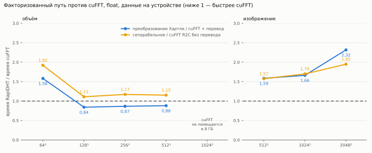
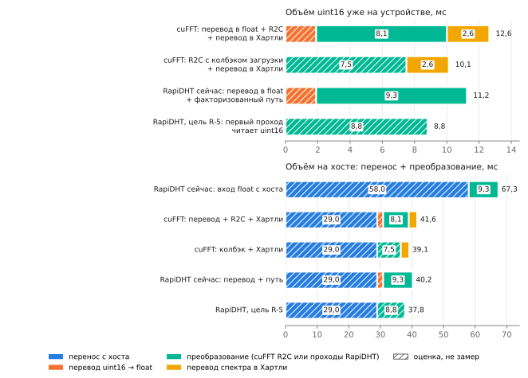
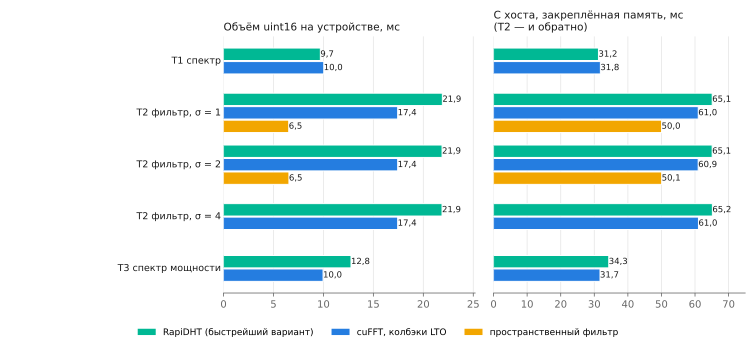
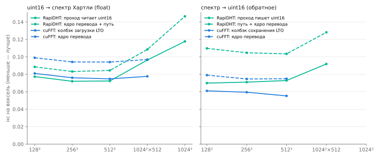

# Benchmarks

Everything below was measured on one machine: six cores at 4.4 GHz and an
RTX 3060 Ti (8 GiB), median of seven repetitions unless noted. Absolute numbers
say as much about that machine as about the library; the ratios are the point.

To reproduce, see [Running the benchmarks](#running-the-benchmarks) at the end.

---

## 3D volumes

This is what the library is for. `GPU` copies the volume across the bus on every
call, which is what the host-pointer overloads do; `Resident` keeps it on the
card through `DeviceVolume`.


| | CPU | GPU | Resident | Resident vs CPU |
| --- | ---: | ---: | ---: | ---: |
| f32 128³ | 1 586 µs | 2 129 µs | **261 µs** | 6.1× |
| f32 256³ | 18 467 µs | 17 684 µs | **3 035 µs** | 6.1× |
| f32 512³ | 247 634 µs | 160 305 µs | **44 157 µs** | 5.6× |
| f64 128³ | **2 811 µs** | 10 485 µs | 6 710 µs | 0.42× |
| f64 256³ | **40 449 µs** | 133 803 µs | 104 015 µs | 0.39× |
| f64 512³ | **442 164 µs** | 1 901 526 µs | 1 662 816 µs | 0.27× |

All columns from one run on 2026-11-06, after B-106
(`benchmarks/results/2026-11-06_evgeny.json`), `OMP_NUM_THREADS=6`. The device
figures agree with the previous run to within 2%; the CPU ones are 9–23× faster
than before B-106 (14 989 / 416 096 / 4 155 799 µs in f32 and 25 446 / 479 546 /
4 959 353 µs in f64). **In double precision the CPU now beats the GPU**, resident
or not, by 2.4–3.8×; in single precision the resident GPU leads by about 6×, not
the 57–136× this table used to show. The chart above predates both B-106 and
the removal of the device transposes and should be redrawn.

What the transposes cost, resident, f32:

| | before | after | |
| --- | ---: | ---: | ---: |
| 128³ | 800 µs | 264 µs | 3.0× |
| 256³ | 5 026 µs | 3 057 µs | 1.6× |
| 512³ | 58 202 µs | 44 758 µs | 1.3× |

The volume is stored `x` fastest, which cuBLAS reads as column-major, and every
`cas` matrix is symmetric, so each axis is one multiply on the data as it lies.
The path used to wrap them in four transposes and two Y/Z swaps, each a full
pass over the volume; the smaller the volume, the larger the share of the time
they took. In double precision they were never more than noise next to the FP64
GEMMs.

### The bus was hiding the transform

At 512³ the resident figure of 44.8 ms is the transform and nothing else.
Through the copying interface the same work is 1.5× the CPU backend;
resident, it is 5.6× (before B-106 these were 26× and 93×). The difference is the bus: 116 ms of it per call, measured
separately as the `PCIe` case, and 44.8 + 116.0 accounts for the 161 ms the
copying path takes.

The dense `cas` matrix is only `W × W` per axis and is reused once per line,
which turns the work into GEMMs — the case GPUs are built for — rather than the
memory-bound matrix-vector product that a single long 1D transform degenerates
into. The whole transform sustains 9.2 TFLOP/s against a 16.2 TFLOP/s peak,
counting the Bracewell pass as well as the GEMMs.

Of the 44.8 ms, the three GEMMs take about 40 and the Bracewell pass 4.9, timed
separately with CUDA events. A plain copy of the volume takes 2.6 ms, which is
the floor for any pass over it.

### Precision decides the outcome on consumer hardware

A GeForce runs FP64 at a fraction of its FP32 rate, so single precision is 26–38×
faster on the device, against 1.8–2.2× on the CPU. Anyone using the GPU backend
for volumes should be in `float`; in `double` the CPU backend is the faster one. On datacentre cards the ratio is 1:2 rather than
1:64 and the choice matters far less.

### What is worth offloading

This held for the matrix path only. On the matrix path the CPU is faster in
2D at every size measured (1.4–2.3× in f32 at 128²–1024²). The factored path
(R-4, below) changed that: in f32 v2.3 is 1.2×, 9.4× and 8.5× faster than the
CPU at 128², 512² and 1024² (15.0, 30.2 and 156 µs against 18.3, 285 and
1 321 µs; `…_r4_f64_2d.json`, resident data, so without the bus). In 1D the matrix path is 66–80× slower than the CPU: the axis is the
whole signal, so the matrix is `n × n`, and at n = 262 144 it would need 512 GiB.
The benchmark does not register GPU cases whose matrices exceed 1 GiB.

---

## Against cuFFT

cuFFT computes the Fourier transform, but for real input the Hartley transform
follows by one linear pass, `Re(X) − Im(X)`, so cuFFT plus an `O(N)` conversion
computes exactly what this library computes. That makes it the baseline that
matters.

At 512³ in single precision, both on data already resident on the device, both
measured in the same run:

| | time | arithmetic | achieved | extra device memory |
| --- | ---: | ---: | ---: | ---: |
| RapiDHT, matrix | 44.8 ms | 412 GFLOP | 9.2 TFLOP/s | **556 MiB** |
| cuFFT + conversion | **12.1 ms** | ~9 GFLOP | 0.75 TFLOP/s | 1 028 MiB |

(Measured with the first conversion pass; with the faster one of 2026-11-13 the
baseline is 10.74 ms — see the R-4 section below.)

**cuFFT is 3.7× faster on the transform.** That is the number to quote. The gap
narrows at smaller volumes -- 1.35× at 128³ and 2.0× at 256³ -- because an FFT's
advantage grows with the size of the problem, not shrinks.

Two measured facts sit alongside it:

- The matrix path performs about **46× more arithmetic** yet finishes only 3.7×
  behind, because it is compute-bound and reaches 57% of the card while an FFT
  is bandwidth-bound and reaches around 5%.
- It needs **about half the extra device memory** — 556 MiB, measured with
  `cudaMemGetInfo` (`profile_gpu3d`): 512 MiB of scratch, 3 MiB of matrices and
  about 41 MiB that the cuBLAS handle takes — against cuFFT's 1 028 MiB of
  spectrum and workspace, read from `cufftGetSize3d` (which leaves out cuFFT's
  own handle overhead). On this card that is a largest cubic volume of about 997³
  against about 871³.

  *Correction (B-003):* this table used to say 515 MiB while the transform, at
  construction, also allocated a host-staging buffer the size of the volume:
  it really held 1 068 MiB, more than cuFFT. Since B-003 that buffer is
  allocated on the first host-pointer call only. Measured on 2026-11-06
  (`benchmarks/results/2026-11-06_evgeny_memory.txt`), f32 512³: 556 MiB after
  construction and after resident use, 1 068 MiB once a host-pointer call has
  run; f64: 1 068 and 2 092 MiB.

The table settles neither of the two things that would decide the question. A
GEMM maps onto tensor cores and an FFT does not, so the gap is a property of the
card as much as of the algorithm. And the transform is one stage of a filtering
pipeline, where a Hartley spectrum multiplies an even kernel with a real
Hadamard product rather than a complex one.

### Tensor cores on this card

Measured with cuBLAS on the three 512³ GEMMs alone, outside the library:

| compute | GEMMs | rate | whole transform, estimated |
| --- | ---: | ---: | ---: |
| FP32 | 40.6 ms | 10 TFLOP/s | 44.8 ms (measured) |
| TF32 | 25.6 ms | 16 TFLOP/s | ~30 ms |
| FP16 in, FP32 accumulate | 13.2 ms | 31 TFLOP/s | ~18 ms |

The estimate adds the 4.9 ms Bracewell pass. None of them reaches cuFFT's
12.1 ms, and the lower precisions carry their own cost: TF32 keeps 10 bits of
mantissa, a relative error around 1e-3, which has not been checked against the
tolerances of the test suite.

On a GeForce, TF32 runs at the FP32 rate. The 32.4 TFLOP/s on the spec sheet is
the figure with structured sparsity, which a dense `cas` matrix cannot use; the
16 TFLOP/s measured here is the dense rate.

### Extrapolating to other hardware

Spec-sheet arithmetic, not measurement, and it points somewhere uncomfortable.
Dense rates throughout.

| | FP32 | TF32 tensor | bandwidth | FLOP/byte |
| --- | ---: | ---: | ---: | ---: |
| RTX 3060 Ti | 16.2 T | 16.2 T | 448 GB/s | 36 |
| A100 | 19.5 T | 156 T | 1 555 GB/s | 13 |
| H100 | 67 T | 495 T | 3 350 GB/s | 20 |

Scaling the 44.8 ms by the arithmetic rate, at the same efficiency, and cuFFT's
12.1 ms by the bandwidth. That flatters RapiDHT a little: its Bracewell pass is
bound by bandwidth too, and is scaled here as if it were arithmetic.

| at 512³ | RapiDHT, FP32 | RapiDHT, TF32 | cuFFT | gap, FP32 | gap, TF32 |
| --- | ---: | ---: | ---: | ---: | ---: |
| A100 | 37 ms | 4.7 ms | 3.5 ms | 10.7× behind | 1.3× behind |
| H100 | 11 ms | 1.5 ms | 1.6 ms | 6.7× behind | parity |

A datacentre card adds bandwidth first, and bandwidth is what an FFT runs on.
**Tensor cores are the condition for the approach staying viable on newer
hardware, but not enough to win**: even on an H100 they only bring it level,
and at TF32 precision. Beating cuFFT outright takes a fast algorithm with the
same few passes over memory, not faster multiplies.

---

## CPU backend after B-106

Two changes, both in `src/backend_cpu.cpp`:

- **Bracewell pass in place, by orbits.** Each output reads the separable
  spectrum only at its own point and at its mirror images, so the points split
  into orbits of up to 8 under the axis flips. Every orbit is read once and
  written once, with the fastest axis innermost. The full-size result buffer,
  the final copy and the strided `collapse(3)` loop are gone.
- **1D passes on blocks of 32 lines.** Neighbouring lines are gathered into a
  buffer laid out `[index along the axis][line]`, so every butterfly is a short
  contiguous loop across lines that the compiler vectorises, and the strided
  gather is paid once per block. No allocation per line any more.

Measured in a cloud container (Xeon @ 2.1 GHz, 2 threads, `-O3`, best of 3–5),
before and after, same machine, same run. Not comparable with the table above.

| | before | after | |
| --- | ---: | ---: | ---: |
| f32 128³ | 77.0 ms | 6.3 ms | 12× |
| f32 256³ | 932.7 ms | 58.7 ms | 16× |
| f64 128³ | 81.1 ms | 10.3 ms | 8× |
| f64 256³ | 1 411 ms | 126.4 ms | 11× |

The Bracewell share of the 256³ transform fell from 61–70% to 5–13%, and
`float` is now about twice as fast as `double` instead of on par, which is what
vectorised butterflies should give. For scale, `scipy.fft.rfftn` (pocketfft) on
the same container with 2 workers takes 6.1 ms at 128³ and 49.5 ms at 256³ in
`float` -- RapiDHT is within 1.05–1.2× of it while computing the true rather
than the separable transform. On the desktop, see the table at the top and
[FFTW, for reference](#fftw-for-reference).

---

## The separable transform (B-102)

`ForwardSeparable` skips the Bracewell pass; it is what an even-kernel
convolution runs. f32, `OMP_NUM_THREADS=6`, median of 7, 2026-11-06
(`benchmarks/results/2026-11-06_evgeny_separable.json`):

| | CPU | CPU separable | | Resident | Resident separable | |
| --- | ---: | ---: | ---: | ---: | ---: | ---: |
| 128² | 25.9 µs | 23.4 µs | −10% | 34.3 µs | 28.1 µs | −18% |
| 512² | 286 µs | 263 µs | −8% | 408 µs | 397 µs | −3% |
| 1024² | 1 301 µs | 1 258 µs | −3% | 3 018 µs | 2 978 µs | −1% |
| 128³ | 1 691 µs | 1 555 µs | −8% | 261 µs | 242 µs | −7% |
| 256³ | 18.6 ms | 15.7 ms | −15% | 3.01 ms | 2.84 ms | −6% |
| 512³ | 239 ms | 214 ms | −10% | 44.1 ms | 42.3 ms | −4% |

On the device the 3D saving is 1.85 ms at 512³, not the 4.9 ms the Bracewell
kernel takes: three out-of-place multiplies leave the separable spectrum in the
scratch buffer, and copying it back costs about 2.6 ms of the 4.9. Ending the
multiplies in the caller's buffer instead would need an in-place multiply or an
even number of passes. Either way the transform is GEMM-bound -- the
correction was never more than a tenth of it -- so skipping it is worth having
but does not change the picture.

---

## The factored device path (R-4, experimental)

### The full table (R-4 step 5.2, 2026-11-25)

Desktop, RTX 3060 Ti, `native` (sm_86) build, f32, data resident on the
device, median of 7 (`benchmarks/results/2026-11-25_evgeny_r4_s52_full.json`,
`R4_FULL=1 bash scripts/r4_measure.sh s52_full`; cuFFT from the same run).
Two pairs, like against like: the true Hartley transform against cuFFT R2C plus
its conversion to the Hartley spectrum, and the separable transform (no
Bracewell pass) against the bare R2C transform. A ratio below 1 is faster than
cuFFT.



| | Hartley | cuFFT + conversion | ratio | separable | cuFFT R2C | ratio | extra memory, ours / cuFFT |
| --- | ---: | ---: | ---: | ---: | ---: | ---: | ---: |
| 64³ | 31.8 µs | 20.1 µs | 1.58 | 31.4 µs | 16.4 µs | 1.92 | < 2 / 2.1 MiB |
| 128³ | 147 µs | 175 µs | **0.84** | 147 µs | 132 µs | 1.11 | < 2 / 16 MiB |
| 256³ | 1.15 ms | 1.33 ms | **0.87** | 1.17 ms | 1.00 ms | 1.17 | 32 / 129 MiB |
| 512³ | 9.39 ms | 10.66 ms | **0.88** | 9.27 ms | 8.05 ms | 1.15 | 32 / 1 028 MiB |
| 1024³ | 142 ms | does not fit | — | 130 ms | does not fit | — | 32 MiB / — |
| 512² | 27.8 µs | 17.6 µs | 1.59 | 21.9 µs | 13.9 µs | 1.57 | < 2 / 2.0 MiB |
| 1024² | 118 µs | 70.9 µs | 1.66 | 86.4 µs | 50.9 µs | 1.70 | < 2 / 8.0 MiB |
| 2048² | 660 µs | 285 µs | 2.32 | 397 µs | 204 µs | 1.95 | < 2 / 32 MiB |

- **Where it wins.** The factored transform beats cuFFT plus conversion on
  volumes from 128³ to 512³, by 12–16 %. It does not beat the bare R2C
  transform anywhere (1.11–1.17 at those sizes): Hartley has no half-spectrum
  saving; `docs/R4_PLAN.md`, section 2, explains why that bar is out of reach
  on this card.
- **Where it loses.** At 64³ (1.6 times) and on every 2D image (1.6–2.3
  times, worst at 2048²). Every R-4 step was measured and tuned on 128³–512³
  volumes only; 64³ and 2D entered the measurements at step 5.2. Why these
  cases are slow has not been measured.
- **Memory.** Ours is the device memory in use after the first call minus with
  the volume alone (`extraMiB` of `FactoredResident/`, new in step 5.2): no
  change the driver can see up to 128³ and in 2D, 32 MiB — the granularity
  of the CUDA memory pool — from 256³. cuFFT's is the half spectrum plus the
  workspace `cufftGetSize` reports.
- **Largest volume.** 1024³ (4 GiB) in place, in 142 ms (198 ms at step 0.5,
  `…_r4_1024.txt`). cuFFT's plan fails there (`cufftPlan3d`, code 5): its
  half spectrum alone is 4 104 MiB. The largest cube cuFFT fits beside the
  volume on this card is 512³.

Accuracy, f32 against the CPU backend in double, relative to the RMS of the
spectrum of zero-mean white noise (SplitMix64), largest error over the volume
(`…_r4_s52_accuracy.txt`, `benchmarks/accuracy_gpu3d 64 128 256 512`):

| | 64³ | 128³ | 256³ | 512³ |
| --- | ---: | ---: | ---: | ---: |
| cuFFT + conversion | 1.40e-6 | 1.41e-6 | 1.90e-6 | 2.21e-6 |
| factored | 8.24e-7 | 1.00e-6 | 1.16e-6 | 1.48e-6 |
| factored / cuFFT | **0.59** | **0.71** | **0.61** | **0.67** |
| matrices | 6.60e-5 | 1.43e-4 | 3.08e-4 | 6.82e-4 |

The RMS error is lower than cuFFT's at every size too. On the tests' LCG
noise the ratio is 0.41 / 0.58 / 0.65 / 2.04 (see R-4a below for the 512³
outlier). Not measured: 2D accuracy (the tool is 3D only) and 1024³ (the
tool needs about 48 GiB of host memory there, the machine has 32).

### Convolution (R-4 step 5.3, 2026-11-25)

A transform is usually taken for a convolution: forward, multiply by the
kernel's spectrum, back. Same machine and build, f32, resident, median of 7
(`…_r4_s53_conv.json`, `R4_CONV=1 bash scripts/r4_measure.sh s53_conv`):

- **Hartley, any kernel** (`ConvHartley/`): the true transform, the product of
  the convolution theorem `Z(k) = F(k)E(k) + F(−k)O(k)` (E, O the even and
  odd parts of the kernel's spectrum, one thread a pair k, −k, in place), the
  true transform again.
- **Hartley, even kernel** (`ConvHartleyEven/`, the hno-porous windows): the
  separable transform, a pointwise product, the separable transform.
- **cuFFT** (`ConvCufft/`, `ConvCufftEven/`): R2C, the product with the
  kernel's half spectrum (complex, or real for an even kernel), C2R. Both plans
  share one work area; the kernel is staged in the caller's volume. That is
  cuFFT at its leanest.

Every case is checked once before it is timed, at four points against the
definition of circular convolution summed in double and, where cuFFT fits, in
full against cuFFT (`benchmarks/convolution_gpu.cu`, `bench_transform.cpp`).
The kernel is a Gaussian, σ = n/32, off-centre for "any kernel".

| | Hartley, any kernel | cuFFT | ratio | Hartley, even kernel | cuFFT, even | ratio | memory, Hartley / cuFFT |
| --- | ---: | ---: | ---: | ---: | ---: | ---: | ---: |
| 64³ | 70.9 µs | 33.6 µs | 2.11 | 68.5 µs | 32.2 µs | 2.13 | 1 / 3.1 MiB |
| 128³ | 364 µs | 324 µs | 1.13 | 361 µs | 314 µs | 1.15 | 8 / 24 MiB |
| 256³ | 2.82 ms | 2.49 ms | 1.14 | 2.81 ms | 2.41 ms | 1.17 | 64 / 194 MiB |
| 512³ | 22.9 ms | 20.0 ms | 1.15 | 22.2 ms | 19.3 ms | 1.15 | 512 / 1 542 MiB |
| 1024 × 1024 × 512 | 117 ms | does not fit | — | 103 ms | does not fit | — | 2 048 MiB / — |
| 512² | 62.9 µs | 28.2 µs | 2.23 | 49.9 µs | 27.4 µs | 1.82 | 1 / 3.0 MiB |
| 1024² | 276 µs | 128 µs | 2.16 | 210 µs | 122 µs | 1.72 | 4 / 12 MiB |
| 2048² | 1.47 ms | 527 µs | 2.79 | 916 µs | 507 µs | 1.81 | 16 / 48 MiB |

Memory is what each convolution allocates beside the volume (`allocMiB`): for
Hartley the kernel's spectrum, one volume; for cuFFT the data's half
spectrum, the kernel's half spectrum and the work area (for an even kernel,
the real half spectrum). The even-kernel cuFFT figure is 1 285 MiB at 512³.
The driver sees 32 MiB more for Hartley from 256³ (the library's memory pool)
and a few MiB more for cuFFT (`extraMiB`).

- **Time.** The convolution is slower than cuFFT's at every size: by 13–17 %
  on 128³–512³ volumes, and by 1.7–2.8 times at 64³ and in 2D. The transform
  alone beat cuFFT plus conversion by 12–16 % on the same volumes. In a
  convolution cuFFT does not need the conversion. So the comparison is two of
  our transforms against R2C plus C2R, and against the bare R2C the
  transform was already 1.11–1.17 times slower (step 5.2). The products cost
  about the same on both sides (one read of the volume and of the kernel's
  spectrum, one write).
- **Memory.** A third of cuFFT's (512 against 1 542 MiB at 512³). Only
  Hartley convolves 1024 × 1024 × 512 (2 GiB) on the 8 GB card: it needs
  4 GiB, cuFFT about 8. 1024³ fits neither: its volume and one kernel spectrum
  alone are 8 GiB.
- The even kernel gains nothing on volumes (the Bracewell pass is already
  folded into the x pass) and 20–38 % in 2D, where the true transform is the
  slower one.

### CUDA 13.2 against 12.4 (R-5 step 0.0a, 2026-11-25)

Every R-4 figure above was taken with Ubuntu's CUDA 12.4 (nvcc 12.4.131,
cuFFT 11.2, host compiler g++-13). From R-5 on the desktop builds with NVIDIA's
CUDA 13.2 (nvcc 13.2.51, cuFFT 12.2, host compiler the system GCC 15, which
13.2 accepts). Same code, same `native` (sm_86) build, f32, resident, median of
7; base `…_r4_s51_b2.json` (12.4), new `…_r4_cuda13_base.json` (13.2), verdict
by `tools/r4_compare.py`:

| | 128³ | 256³ | 512³ |
| --- | ---: | ---: | ---: |
| cuFFT C2C + Hartley conversion | 175.0 µs (+0.1 %) | 1.333 ms (+0.0 %) | 10.657 ms (−0.0 %) |
| cuFFT R2C | 132.7 µs (+0.2 %) | 1.003 ms (−0.0 %) | 8.043 ms (−0.0 %) |
| FactoredResident | 147.8 µs (+0.6 %) | 1.152 ms (−1.3 %) | 9.383 ms (−0.1 %) |
| FactoredResidentSeparable | 147.3 µs (+0.5 %) | 1.170 ms (−1.7 %) | 9.247 ms (−0.1 %) |

All twelve rows are within noise (3 % threshold): the toolkit moves neither
cuFFT nor the factored kernels, and the ratios against cuFFT stay as they were
(0.84–0.88 of cuFFT + conversion, 1.11–1.17 of bare R2C). The R-4 figures may
still be read next to R-5 ones, but R-5 compares only runs taken on 13.2.

The first 13.2 build linked cudart, cuBLAS and cuFFT 12.4: Ubuntu's
`nvidia-cuda-dev` had stayed behind with `libcudart.so` and `libcufft.so` in
`/usr/lib/x86_64-linux-gnu`, which FindCUDAToolkit preferred, while the headers
came from 13.2. The tests passed. `CMakeLists.txt` now refuses to configure when
the runtime library's version differs from nvcc's.

### How it got there

`Modes::GPUFactored` replaces each dense `N x N` multiply by two small ones,
`N = N1 * N2` (512 = 32 * 16): 96 multiply-adds per element and axis instead
of 1 024. Each axis is one kernel that holds a block of lines in shared memory
and works in place; the Bracewell pass runs in place too. It holds no scratch
buffer, no matrices and no cuBLAS handle. Resident, f32, median of 7.
v2.2 -- one block of lines per thread block, 2026-11-06
(`benchmarks/results/2026-11-06_evgeny_factored_v2.2.json`); v2.3 -- a
pipelined grid that fetches the next block of lines into registers while it
computes the current one, with every shared-memory access laid out against bank
conflicts, 2026-11-13 (`…_2026-11-13_evgeny_factored_v2.3.json`; v2.2 from the
same build, `RAPIDHT_FACTORED_KERNEL=v2`, in `…_v2.2_samebuild.json`):

| | matrices | factored v2.2 | factored v2.3 | cuFFT + conversion | cuFFT R2C alone |
| --- | ---: | ---: | ---: | ---: | ---: |
| 128³ | 261 µs | 345 µs | 332 µs | **176 µs** | 133 µs |
| 256³ | 3.02 ms | 2.43 ms | 2.00 ms | **1.34 ms** | 1.01 ms |
| 512³ | 44.2 ms | 25.3 ms | 18.0 ms | **10.74 ms** | 8.11 ms |
| 512³, separable | — | 22.7 ms | 15.4 ms | — | — |
| 512³, f64 | 1 651 ms | **150 ms** | 150 ms (v2 kernel, see below) | — | — |
| 1024², 2D | 3.04 ms | 0.29 ms | **0.156 ms** | — | — |
| extra device memory, 512³ f32 | 556 MiB | **32 MiB** | **32 MiB** | 1 028 MiB | 1 028 MiB |

Device code: until 2026-11-14 every GPU figure in this file was taken with the
`all-major` build, which has no sm_86 code, so the RTX 3060 Ti ran the sm_80
kernels. From 2026-11-15 the `cuda`, `bench` and `dev` presets build for the
card in the machine (`native`); on sm_86 the factored path is 19 % faster at
128³, 3.8 % at 512³ and 4.1 % slower at 256³ (its z axis, R-4 step 2.0a), and
cuFFT, which ships its own kernels, is unchanged.

The cuFFT columns are from 2026-11-13 (`…_r4_cufft_pairs.json`, R-4 step 0.3).
Before that the conversion pass looped over the outputs and read every stored
coefficient twice: 3.87 ms at 512³, and the baseline was quoted as 12.0 ms,
1.51 ms and 196 µs. The conversion now reads each coefficient once and writes
both H(k) and H(−k): 2.62 ms, the time of one copy of the volume. The baseline
is to be beaten at its strongest, so the faster one is the only one kept.
cuFFT's 1 028 MiB are the half spectrum (514 MiB) plus the workspace
`cufftGetSize3d` reports (514 MiB); an in-place R2C would need rows padded to
2(W/2 + 1) floats, which this library's layout does not have.

The 32 MiB are the CUDA memory pool's granularity; the tables themselves are
a few KiB. Not usable: `2026-11-06_evgeny_factored_v2.1.json` is truncated
(the run crashed on the event-destruction bug fixed in v2.2), so v2.1 has no
measured effect of its own; its change is part of v2.2 and v2.3.

Per kernel, f32 (`RAPIDHT_TRACE_KERNELS=1`, median of the calls after the
first; v2.3 from `…_r4_base_trace.txt` and `…_r4_1024.txt`). The Bracewell pass
reads and writes the volume once and runs at the speed of a copy, so its time
is the yardstick for the others:

| | x (fastest) | y | z | Bracewell |
| --- | ---: | ---: | ---: | ---: |
| v2.2, 512³ | 8.6 ms | 6.9 ms | 6.9 ms | 2.6 ms |
| v2.3, 128³ | 0.097 ms | 0.097 ms | 0.097 ms | 0.042 ms |
| v2.3, 256³ | 0.557 ms | 0.551 ms | 0.559 ms | 0.331 ms |
| v2.3, 512³ | 3.97 ms | 5.11 ms | 6.09 ms | 2.62 ms |
| v2.3, 1024³ | 50.9 ms | 58.6 ms | 66.4 ms | 21.3 ms |

In double the pipelined kernel is slower than v2 (164 against 151 ms at 512³,
2.11 against 1.48 ms at 128³, same build, `…_r4_s20_f64_{v23,v2}.json`): it
needs 168 registers a thread in double, so one block fits on an SM. Since
2026-11-15 double runs the v2 kernel and float the pipelined one (R-4 plan
step 2.0). In 2D float
it is 13–47 % faster than v2.

Since then, on the sm_86 build, with every division in the pipelined kernel
replaced by shifts (R-4 step 2.1, `…_r4_s21.json`): 238 µs, 1.89 ms and
15.8 ms at 128³, 256³ and 512³ — 1.36, 1.41 and 1.47 times cuFFT with its
conversion. Axis x at 512³ takes 2.99 ms, 1.14 times a copy of the volume.
With wider batches on short axes (32 lines at n = 128, 16 at 256; step 2.2,
`…_r4_s22.json`): 210 µs and 1.64 ms at 128³ and 256³ — 1.19 and 1.22 times
cuFFT; 512³ unchanged at 15.8 ms (1.48 times).
With the batch width chosen per axis from a sweep of 4/8/16/32 lines (z 16;
x 16 up to n = 256, else 8; y 16 at 128, else 8; step 2.4,
`…_r4_s24_{a2,b2}.json`, measured back to back): 189 µs, 1.57 ms and 15.3 ms
at 128³, 256³ and 512³ — 1.07, 1.18 and 1.43 times cuFFT with its conversion.
With the Bracewell combination folded into the last pass along x (groups of
four mirror lines per quad; step 3.3, `…_r4_s33_{a,b}.json`, back to back):
157 µs, 1.36 ms and 13.8 ms — **0.90, 1.02 and 1.29 times cuFFT** with its
conversion. At 128³ the factored transform is now faster than cuFFT.
With steps 1-2 done in place in registers where that wins (no work buffer,
so more blocks fit an SM; chosen per axis and length, step 4B,
`…_r4_s4bh{_a,}.json`, back to back): 158 µs, 1.27 ms and 12.36 ms — **0.90,
0.95 and 1.15 times cuFFT**. At 128³ and 256³ the factored transform is faster
than cuFFT with its conversion.
With step 1's twiddle folded into registers in the two kernel variants where
it wins (the fused x pass through the work buffer, the two-tile axis kernel;
step 4A, `…_r4_s4as{_a,}.json`, 2026-11-19, back to back): 147 µs, 1.19 ms
and 12.0 ms — **0.83, 0.89 and 1.12 times cuFFT** with its conversion.
Per-kernel traces at 512³ from `profile_gpu3d` run right after the benchmark
proved unreliable in this step and in `…_r4_s4a_a` (kernels whose code did
not change moved by 10-25 %); the benchmark figures are the ones to trust.
That noise was the GPU boosting its clock part-way through a trace; since
2026-11-19 the trace runs at a locked 1665 MHz and per-kernel figures are
compared by their minima (`scripts/r4_measure.sh`, A-A check within 0.5 %).
With the sizes compiled in as constants for the kernels where that wins
(fused x pass at 128/256/512, the axis kernel at 128, z at 512; step 4D,
`…_r4_s4ds{_a,}.json`, 2026-11-20, back to back): 145 µs, 1.15 ms and
11.26 ms — **0.83, 0.86 and 1.05 times cuFFT** with its conversion.
With the y pass at 512³ taking 16 lines and two tiles a thread, like z
(step 4.Y, `…_r4_s4y{_a,}.json`, back to back): 10.09 ms at 512³, the y pass
4.51 → 2.82 ms — **0.83, 0.86 and 0.94 times cuFFT** with its conversion. The
factored Hartley transform is now faster than cuFFT plus its conversion to the
Hartley spectrum at all three sizes, with 32 MiB of extra device memory
against cuFFT's 1 028 MiB at 512³.
Step 4.Z: the z pass at 512³ was bound by memory alone (3.62 ms moving
the data against 3.10 along y, same kernel). `benchmarks/stride_probe` showed
why: with 16 lines a row of a batch is 64 contiguous bytes and the line sets
move at 3.57 ms along z; with 32 lines, 128 bytes, they move at 2.61 ms, the
speed of a plain copy (2.59). z at 512 now takes 32 lines in a four-tile
kernel that fetches its next batch in quarters inside the steps: z 3.64 →
3.24 ms, the full transform 10.09 → **9.66 ms (0.904 times cuFFT plus
conversion)**, the separable one 9.26 ms (`…_r4_s4z.json` against
`…_r4_s4y.json`).
The separable pass along x also takes 16 lines at 512 (step 4.X,
`…_r4_x512_{cur,wide}.json`): the separable transform 10.02 → 9.72 ms; the
fused last pass keeps 8, with 16 it was 17 % slower.
Step 4.XG: the fused x pass at 512³ ran 2.5 times the integer instructions of
the y pass (`…_r4_x512_ncu2.txt`), from the division by the number of y groups
in each mirror line's offset, taken once a value. It is now taken once a
batch: the x pass 3.15 → 2.93 ms, the full transform 9.65 → **9.34 ms (0.874
times cuFFT plus conversion, 10.68 ms in the same run)**, the separable one
unchanged at 9.23 ms (`…_r4_xg_b2.json` against `…_r4_xg_a2.json`, back to
back, 2026-11-25; the first A–B, `…_r4_xg{_a,}.json`, gave −3.2 %).
Step 5.1 removed the R-4 switches (`RAPIDHT_FACTORED_KERNEL`, `RAPIDHT_R4_ABLATE`)
with no change outside noise (`…_r4_s51_b2.json` against `…_r4_s51_a2.json`:
9.39 against 9.33 ms at 512³). **`…_r4_s51.json` is unusable**: the machine was
busy during that run and cuFFT itself moved by +26 % at 512³.

The axes differ only from 512³ up; at 128³ and 256³ all three take the same
time (2.3 and 1.7 Bracewell passes).

Bracewell already runs at the bus limit. In v2.3 the fastest axis is the
quickest and y and z are now the slow ones. Why is not established: v2.3
changed three things at once (the pipeline, the shared-memory layout, moving
lines in quads), and the per-axis difference has not been isolated by a
measurement. The float result at these extents is checked against the CPU
backend by `FactoredFloatAgreesWithCpuOnBenchmarkExtents_GPU`; single-precision
error, measured on the device against the CPU backend in double
(`benchmarks/accuracy_gpu3d`, `2026-11-20_…_r4_accuracy.txt`), relative to the
RMS of the spectrum of zero-mean white noise (SplitMix64):

| | 256³ largest | 256³ RMS | 512³ largest | 512³ RMS |
| --- | ---: | ---: | ---: | ---: |
| cuFFT + conversion | 1.90e-6 | 2.76e-7 | 2.21e-6 | 3.18e-7 |
| factored | 1.16e-6 | 2.02e-7 | 1.48e-6 | 2.39e-7 |
| matrices | 3.08e-4 | 4.18e-5 | 6.82e-4 | 8.42e-5 |

The tests' LCG noise is not white: sampled at power-of-two strides it falls on
a lattice, rounding errors of the sums along an axis come out correlated, and
both transforms show outliers well above their white-noise level
(7–9 times for cuFFT, 8–26 times for the factored path). There the
largest errors are 1.41e-5 / 1.92e-5 for cuFFT and 9.20e-6 / 3.92e-5 for the
factored path (256³ / 512³). The factored outlier comes from the z pass at
k_z = 0; a float32 NumPy model of the algorithm (`tools/r4_factored_emu.py`)
reproduces it, so it belongs to the summation order on that input, not to a
kernel (R-4a).

**Largest volume on the 8 GB card, float** (`…_r4_1024.txt`, R-4 step 0.5):
the factored path transforms 1024³ (4 GiB) in place in 198 ms, holding the
same 32 MiB beside the volume. The cuFFT baseline does not fit: with the volume
resident about 2 970 MiB remain, and the half spectrum alone is 4 104 MiB
(`cufftPlan3d` returned code 5, `CUFFT_INTERNAL_ERROR`). At 1024³ the axes run
at 2.4–3.1 times the copy time against 1.5–2.3 at 512³; one block per SM fits
there (77 KiB of shared memory), which is a likely but unmeasured cause.

The factored path has the smaller RMS error at both sizes, but at 512³ its
largest error is 3.3 times cuFFT's (backlog R-4a). The matrix path sums each
output over the whole axis in one dot product and is 20–40 times less
accurate than either.
The review of this track and the plan from here are in `docs/R4_PLAN.md`.

---

## Integer volumes: accuracy (R-5, 2026-11-25)

Tomographs write uint8 or uint16 volumes. Would integer arithmetic make the
transform more accurate on them? `benchmarks/accuracy_integer` transforms
white integer noise in float on the device and compares the result with the CPU
backend in double, which is exact here. Errors are given in units of the
input's least significant bit (error / √N), against two floors that no
arithmetic inside the transform can go below (`…_r5_integer_accuracy.txt`):

- **Input quantisation.** The noise of rounding to integers reaches each
  coefficient with RMS 0.289 LSB. Its largest value over 512³ coefficients is
  about 1.6 LSB.
- **Float output.** The exact spectrum rounded to float.

512³, over the non-zero frequencies, in LSB:

| input | | cuFFT + conversion, RMS / largest | factored, RMS / largest | float output floor, RMS |
| --- | --- | ---: | ---: | ---: |
| uint8, 0..255 | raw | 2.4e-5 / 0.036 | 2.5e-5 / 0.056 | 1.9e-6 |
| | minus 128 | 2.3e-5 / 1.8e-4 | 1.7e-5 / 1.6e-4 | |
| uint16, 0..65535 | raw | 7.4e-3 / **14.5** | 7.1e-3 / **23.6** | 4.8e-4 |
| | minus 32768 | 6.0e-3 / 0.044 | 4.4e-3 / 0.027 | |
| uint16, 30000 ± 2000 (a tomogram's band) | raw | 2.5e-3 / **8.1** | 5.4e-3 / **23.5** | 2.9e-5 |
| | minus 32768 | 4.7e-4 / 1.13 | 5.5e-4 / 1.72 | |
| | minus the rounded mean | 3.7e-4 / 2.6e-3 | 2.7e-4 / 1.6e-3 | |

- **The RMS error is no issue.** It is 40–20 000 times below the input's own
  rounding noise in every case, raw or not.
- **The largest error is the issue, and it comes from the mean.** On raw
  uint16 data the worst coefficients are off by 8–24 LSB, 5–15 times the worst
  quantisation noise. The large mean puts a large zero-frequency coefficient
  into every partial sum, and the coefficients that share its lines inherit
  its rounding. This holds for cuFFT and for the factored path alike; raw, the
  factored path is the worse of the two (1.6–2.9 times).
- **Subtracting an integer offset fixes it.** The subtraction is exact, and it
  changes only the zero-frequency coefficient, by offset × N, which is added
  back exactly. Minus the rounded mean, the largest error at 512³ falls from
  23.5 to 0.0016 LSB (factored) and from 8.1 to 0.0026 (cuFFT). Half the range
  is enough for full-range data. It is not enough for a narrow band far from
  it: 1.1–1.7 LSB remain.
- **Integer arithmetic inside the transform would not help in practice.**
  Centred, the factored path is 9 times above the float output floor (RMS
  4.4e-3 against 4.8e-4 LSB on full-range uint16). Fixed point with ≥ 24-bit
  twiddles could close that gap, but both figures lie 65 times or more below
  the input's quantisation noise, so the result would not be more accurate as
  data. Fixed point would also need about 43-bit accumulators for uint16 at 512³
  (16 bits of data, 27 of growth), that is int64, which a GeForce emulates.
- Centred, the factored path is the more accurate one: RMS 0.73 and largest
  0.6–0.9 of cuFFT's.

So integer input calls for one integer operation, the offset at the input,
not for integer arithmetic. A first pass that reads uint8 / uint16 can
subtract it at no cost; the mean needs one reduction over the input (or a
known level, such as air or the matrix).

### Real and synthetic tomograms (R-5 step 0.4, 2026-11-25)

The same report on volumes that look like tomograms
(`benchmarks/results/2026-11-25_evgeny_r5_s04_accuracy.txt`, `R5_ACC=1`; the
Korneev columns cut by `tools/r5_tiff_to_raw.py`, hashes in `…_s04.meta.txt`).
Largest error over the non-zero frequencies, in LSB, rounded mean subtracted;
"floor" is the exact spectrum rounded to float -- no float output does better:

| input, uint16 | floor | cuFFT | factored | RMS, factored |
| --- | ---: | ---: | ---: | ---: |
| white noise, full range, 512³ | 0.005 | 0.044 | 0.027 | 0.0044 |
| synthetic cylinder, 128³ | 0.148 | 0.61 | 0.60 | 0.0017 |
| synthetic cylinder, 512³ | 1.23 | 6.04 | 6.66 | 0.0023 |
| C6197A centre, 128³ box | 0.029 | 0.117 | 0.060 | 0.0007 |
| C6197A centre, 512³ | 0.136 | 0.82 | 0.84 | 0.0010 |
| C6203A centre, 128³ box | 0.037 | 0.186 | 0.080 | 0.0012 |
| C6203A centre, 512³ | 0.553 | 1.28 | 0.84 | 0.0016 |
| C6197A, edge of the field of view, 128³ box | 0.153 | 0.39 | 0.31 | 0.0011 |
| C6203A, edge of the field of view, 128³ box | 0.160 | 0.47 | 0.48 | 0.0012 |

- On a tomogram the largest error is set by its few large low-frequency
  coefficients (sample against air, the edge of the field of view), not by
  the arithmetic: the float output alone already rounds them by 0.14--1.2 LSB
  at 512³. Subtracting the mean removes one of them, not the rest. White
  noise, with no large coefficient but the zero one, hid this.
- Both libraries land at 2--7 times the floor and within 1.1 of each other in
  the worst case (synthetic 512³); on the real columns the factored path is
  the more accurate or equal. The RMS error stays at 0.001--0.002 LSB,
  150--300 times below the noise of rounding the input.
- So a bound on the largest error of 0.1 LSB, as R-5 first set it (criterion
  C3), cannot be met by any transform with a float output on real data. The
  bound has to be stated against the floor or in another measure; see
  `docs/R5_PLAN.md`, step 0.4.
- uint8 has no such problem (largest 0.02 LSB at 512³): its coefficients are
  256 times smaller against the same float precision.
- A constant input (the zero corner of a full slice) minus half the range
  gives cuFFT an exact result and the factored path a largest error of
  1.6 LSB (`s04` run by hand, not in the table): the large zero coefficient
  leaks into others in the factored passes. Not looked into.

### Offset policies and the round trip (R-5 step 0.5, 2026-11-25)

Six offsets subtracted on reading, cheapest first: none, half the range, a
known level (here the histogram mode, standing for air or the matrix), the
mean of every 512th and of every 64th line along x, the exact rounded mean.
`benchmarks/results/2026-11-25_evgeny_r5_s05_accuracy.txt`, verdict by
`tools/r5_accuracy_table.py` (`…_s05_accuracy_table.txt`); "floors" is the
largest error over the float floor of the same input. Factored path with the
conversion kernel, largest error in LSB (cuFFT in brackets):

| input, 512³ unless stated | none | half range | known level | every 512th line | every 64th line | exact mean |
| --- | ---: | ---: | ---: | ---: | ---: | ---: |
| C6197A centre | 11.1 (10.9) | 3.68 (3.27) | 1.58 (0.91) | 0.71 (0.82) | **0.53** (0.82) | 0.84 (0.82) |
| C6203A centre | 10.6 (8.25) | 4.71 (1.43) | 3.88 (1.95) | 1.05 (1.28) | **0.94** (1.28) | 0.84 (1.28) |
| C6197A full slice, 1024 × 1024 × 512 | 17.6 (16.4) | 11.9 (16.4) | 15.7 (16.4) | 8.0 (16.4) | **7.7** (16.4) | 7.7 (16.4) |
| C6203A full slice, 1024 × 1024 × 512 | 14.4 (19.6) | 32.2 (19.6) | 14.7 (19.6) | 12.3 (19.6) | **30.0** (19.6) | 30.0 (19.6) |
| synthetic cylinder, uint16 | 11.1 (20.1) | 6.66 (8.05) | 7.24 (6.04) | 6.89 (6.04) | **6.66** (6.04) | 6.66 (6.04) |
| synthetic cylinder, uint8 | 0.048 (0.024) | 0.044 (0.024) | 0.031 (0.024) | 0.031 (0.024) | **0.020** (0.024) | 0.020 (0.024) |

- **Default policy: the mean of every 64th line** -- the cheapest that keeps
  the factored path within RMS 0.01 LSB and 10 float floors on every input of
  512³ and more (1/64 of a reduction pass). The mean of every 512th line
  fails one input (synthetic uint8, 10.4 floors); none, half the range and the
  histogram mode fail several, the narrow CT-like band of white noise worst
  (half the range: 5 000 floors).
- **Round trip: every voxel of every input comes back**, under every policy,
  for both libraries: the float spectrum transformed back and rounded never
  misses (largest |x' - x| 0.082, against 0.5). A first look at C4 on the
  float path; stage 4 checks it on integer output.
- **C3 holds on all inputs but one**: on the C6203A full slice the factored
  path's largest error under the mean is 30 LSB against cuFFT's 19.6 (1.53,
  limit 1.5), while with no offset or the sampled mean of every 512th line it
  is 12--14 (below cuFFT). The mean does not help there -- the hypothesis is
  the leak of a large zero coefficient seen on the constant corner (step 0.4),
  not measured. C3 is accepted on the R-5 kernel (step 3.2), not on this path.
- RMS error under the default policy: 0.001--0.003 LSB on the real volumes,
  100--300 times below the noise of rounding the input.

### The price of the offset (R-5 step 1.2, 2026-11-25)

`IntOffset/` rows of `benchmarks/results/2026-11-25_evgeny_r5_s12.json`: the
exact sum (uint64) of the sampled lines and the rounded mean as a float, both
on the device. The default policy, the mean of every 64th line, takes 18 µs
at 512³ uint16 (0.19 % of the float transform) and 94 µs at 1024³; the exact
mean 0.70 and 5.60 ms (7.5 % of the transform at 512³).

### Reading integers along z (R-5 step 1.1, 2026-11-25)

`stride_probe int` (`benchmarks/results/2026-11-25_evgeny_r5_stride_int.txt`):
a batch of L consecutive lines read whole, converted, written as float to
another buffer, 512³, one block to an SM as the real z kernel. The R-4 rule
holds in bytes, not lines: memory moves at the speed of a copy from 128
contiguous bytes on. For uint16 that is 64 lines, not the 32 of the float
kernel -- 32 lines of uint16 (64 bytes) take 2.29 ms against a floor of 1.94
(1.18), 64 lines 1.97 (1.015). uint8: 1.57 and 1.06 of its floor. Even at 32
lines uint16 is read faster than float (2.29 against 2.61 ms).

### The bus (R-5 step 0.6, 2026-11-25)

One way, host to device, `H2D/` rows of
`benchmarks/results/2026-11-25_evgeny_r5_s06.json` (`R5_BUS=1`):

| | pageable | pinned |
| --- | ---: | ---: |
| u8, 512³ (128 MiB) | 15.1 ms | 10.9 ms |
| u16, 512³ (256 MiB) | 30.2 ms | 21.8 ms |
| f32, 512³ (512 MiB) | 60.5 ms | 43.6 ms |
| 1024³, each type | 8 times the above | 8 times the above |
| rate | 8.25 GiB/s | 11.47 GiB/s |

The rate depends on neither type nor size, so the bus costs bytes: a uint16
tomogram sent as uint16 takes half the time of the float the library accepts
today. From the host, "uint16 → Hartley spectrum" at 512³ is 39--43 ms on every
path (bus 30.2 ms + 9--13 ms on the device), against 69.9 ms for today's float
input -- the type of the input matters more there than any kernel
(`docs/images/r5-budget.svg`).



*Redrawn from `…_r5_s63.json` at step 6.3; the last bar is the measured
integer path with the default policy (`tools/r5_figures.py …_r5_s63.json`).*

## Integer volumes: the cuFFT baseline (R-5 step 0.2, 2026-11-25)

cuFFT has no integer input type. Three ways to give it a uint8 / uint16 volume
resident on the device, each writing the float Hartley transform into a buffer
of its own (`benchmarks/cufft_baseline.{h,cu}`, `cufft_int_callback.cu`,
`cufft_int_lto_callback.cu`):

- **convert** (`cuFFTInt/`): a kernel converts the integers into the float
  output buffer, R2C reads them from there, the Hartley pass writes the result
  back;
- **legacy callback** (`cuFFTIntCb/`): `CUFFT_CB_LD_REAL` reads the integers
  inside cuFFT's first kernel; needs the static cuFFT, so it lives in a shared
  library of its own that hides that cuFFT from the rest of the benchmark;
- **LTO callback** (`cuFFTIntLto/`): the same callback as LTO-IR, linked into
  the plan at run time (`cufftXtSetJITCallback`), shared cuFFT.

All three subtract an offset (half the range) on reading and add offset · N
back to the zero coefficient inside the Hartley pass. Every row is checked
against the CPU in double before it is timed (largest error over the non-zero
frequencies: at most 0.058 LSB, limit 0.5). CUDA 13.2, desktop, median of 7,
`benchmarks/results/2026-11-25_evgeny_r5_s02.json` (`R5_LARGE=1 bash
scripts/r5_measure.sh s02`):

| | convert | legacy callback | LTO callback | float cuFFT + conversion, same run |
| --- | ---: | ---: | ---: | ---: |
| u8, 128³ | 203 µs | 395 µs | **169 µs** | 175 µs |
| u16, 128³ | 208 µs | 396 µs | **170 µs** | |
| u8, 256³ | 1.540 ms | 2.800 ms | **1.292 ms** | 1.333 ms |
| u16, 256³ | 1.579 ms | 2.825 ms | **1.275 ms** | |
| u8, 512³ | 12.30 ms | 15.19 ms | **9.72 ms** | 10.66 ms |
| u16, 512³ | 12.62 ms | 15.42 ms | **10.03 ms** | |
| u8, 1024 × 1024 × 512 | 50.9 ms | fails / 93.3 ms | **41.1 ms** | |
| u16, 1024 × 1024 × 512 | 52.1 ms | fails | **41.8 ms** | |
| 1024³, either type | does not fit | does not fit | does not fit | |

- **The LTO callback is the strongest baseline at every size**, 17–20 % faster
  than the conversion kernel, and with integer input it beats float cuFFT
  itself (u16 512³: 10.03 against 10.66 ms) -- it reads 2 bytes a voxel
  instead of 4. It is the opponent of the integer track from here on.
- The legacy callback is the slowest: 1.2–1.9 times the conversion kernel, as
  reported for CUDA 12.x on NVIDIA's forum. At 1024 × 1024 × 512 its
  `cufftExecR2C` returns `CUFFT_EXEC_FAILED` -- always for u16, for u8 in one
  run of two (`s02`; in `s03` it ran, at 93 ms); the cause was not looked into.
- Memory is the same for all three: input, output, the half spectrum
  (514 MiB at 512³), and no workspace worth counting. Peak: 1.15 GiB (u8) and
  1.25 GiB (u16) at 512³, 4.5 and 5.0 GiB at 1024 × 1024 × 512. 1024³ fails on
  the spectrum (4 GiB beside a 4 GiB output).
- Pitfall: cuFFT finds an LTO callback by its C++ name. An `extern "C"`
  callback is an undefined symbol to it, and the plan fails with
  `CUFFT_NVJITLINK_FAILURE`.

### This library with a conversion kernel (R-5 step 0.3)

Today the library has no kernel that reads integers. `IntConvertFactored/`
runs the conversion kernel of `cuFFTInt/` (the same code) into a float
`DeviceVolume`, the factored path in place, and a one-thread kernel that puts
offset · N back into the zero coefficient. Same input, offset and check
(`benchmarks/results/2026-11-25_evgeny_r5_s03.json`, `R5_LARGE=1`; all R-4 rows
and baselines of `s02` within noise in this run):

| u16 | cuFFT, convert | cuFFT, LTO callback (strongest) | ours, convert | ours, float input | ours/strongest | conversion cost |
| --- | ---: | ---: | ---: | ---: | ---: | ---: |
| 128³ | 208 µs | 170 µs | 186 µs | 148 µs | 1.09 | 38 µs |
| 256³ | 1.581 ms | 1.277 ms | 1.396 ms | 1.152 ms | 1.09 | 0.24 ms |
| 512³ | 12.62 ms | 10.03 ms | 11.32 ms | 9.36 ms | 1.13 | 1.96 ms |
| 1024 × 1024 × 512 | 52.1 ms | 41.8 ms | 58.2 ms | | 1.39 | |
| 1024³ | does not fit | does not fit | 156.1 ms | | | |

uint8 is the same picture: 1.07, 1.05, 1.13 and 1.39 of the LTO callback.

| peak device memory, u16 | cuFFT (any variant) | ours, convert | ratio |
| --- | ---: | ---: | ---: |
| 512³ | 1 284 MiB | 800 MiB | 0.62 |
| 1024 × 1024 × 512 | 5 126 MiB | 3 104 MiB | 0.61 |
| 1024³ | does not fit | 6 176 MiB | -- |

- With a separate conversion pass the integer input costs this library more
  than it costs cuFFT with a callback: at 512³ it is 13 % slower than the
  strongest baseline, though still faster than cuFFT's own conversion route
  (0.90). The conversion pass alone is 1.96 ms at 512³ u16 -- 21 % of the
  float transform, which is what a kernel reading integers would save.
- At 1024 × 1024 × 512 the gap widens to 1.39: from 512³ cuFFT's time grows
  4.2 times, ours 5.1. The conversion pass scales with the volume (about
  7.8 ms expected), so the hypothesis is that the factored path itself slows
  down at this shape; not measured -- the float path has no row at this size.
- Memory: 0.62 of cuFFT's, and 1024³ uint16 runs on the 8 GB card (6.0 GiB),
  which no cuFFT variant does.
- Error: the factored path is the more accurate one on the same input
  (u16 512³: largest 0.028 against 0.042 LSB).

### The first pass reading integers (R-5 steps 2.3–2.4, 2026-11-26)

`IntFactored/`: the z pass reads uint8 / uint16 itself, subtracts the offset in
registers and writes float into the output volume; the other passes run in
place (`benchmarks/results/2026-11-26_evgeny_r5_s24_base.json`; batch widths
of the float path, which the sweep `s24_L{8,16,32}` of step 2.4 confirmed):

| | LTO callback (strongest) | ours, convert | **ours, integer first pass** | /LTO | /convert | ours, float input |
| --- | ---: | ---: | ---: | ---: | ---: | ---: |
| u8 128³ | 170 µs | 180 µs | **149 µs** | 0.88 | 0.82 | 148 µs |
| u16 128³ | 170 µs | 186 µs | **159 µs** | 0.94 | 0.86 | 148 µs |
| u8 256³ | 1.291 ms | 1.367 ms | **1.181 ms** | 0.91 | 0.86 | 1.157 ms |
| u16 256³ | 1.276 ms | 1.397 ms | **1.203 ms** | 0.94 | 0.86 | 1.157 ms |
| u8 512³ | 9.72 ms | 11.02 ms | **10.26 ms** | 1.06 | 0.93 | 9.38 ms |
| u16 512³ | 10.03 ms | 11.32 ms | **10.50 ms** | 1.05 | 0.93 | 9.38 ms |
| u16 512³, wide read (step 2.5) | 10.03 ms | 11.33 ms | **9.69 ms** | 0.97 | 0.86 | 9.41 ms |

Per kernel (`…_s24_base_trace.txt`, clock locked at 1665 MHz, minimum of 15
calls), the z pass, ms: float 0.049 / 0.410 / 3.12, u16 0.056 / 0.441 / 4.09,
u8 0.046 / 0.417 / 3.90 at 128³ / 256³ / 512³. At 512³ the pass reading
integers is 0.8–1.0 ms slower than the float one although it reads half or a
quarter of the bytes; no batch width of 8, 16 or 32 lines removes that. The y
pass after it (the same in-place float kernel) also moves: 3.10 against
2.78 ms at 512³, 0.37 against 0.43 at 256³ -- cause not measured.

Step 2.5 (A-B `…_r5_s25_{a,b}`): at 512³ the z pass from uint16 reads a batch
of 64 lines at once -- each half-warp 128 contiguous bytes, 32 `ushort4` quads
a thread, the 64 registers the float kernel spends on its prefetch -- and
computes it as two tiles of 32 (`FactoredAxisKernelWideFrom`). The pass goes
4.08 → 3.26 ms (float: 3.13), the transform 10.47 → 9.69 ms (−7.5 %), 0.97 of
the LTO callback. Not for uint8: 64 lines of it are 64 bytes, and the pass got
slower (3.91 → 4.24 ms); u8 512³ stays at 1.06 of the callback. Reading 128
lines of uint8 (128 bytes a row) as four tiles was tried and rejected (A-B
`…_r5_s25u8_{a,b}`): the z pass 3.90 → 7.26 ms, the transform 10.23 →
13.51 ms (+32 %) -- the next batch can be fetched only during the last of the
four tiles.

### The inverse into integers (R-5 steps 4.2–4.3, 2026-11-26)

From a spectrum on the device to uint8 / uint16 voxels (`…_r5_s43.json`; the
input restored before each iteration, untimed; every variant first gives back
the integer input voxel for voxel), ms:

| | ours, into integers | ours, float + conversion | cuFFT C2R + conversion | cuFFT C2R, LTO store callback | ours / LTO | ours / float + conversion |
| --- | ---: | ---: | ---: | ---: | ---: | ---: |
| u16 128³ | 0.146 | 0.230 | 0.166 | **0.128** | 1.14 | 0.64 |
| u16 256³ | 1.21 | 1.75 | 1.25 | **1.00** | 1.21 | 0.69 |
| u16 512³ | 9.74 | 13.85 | 10.05 | **7.41** | 1.31 | 0.70 |
| u8 512³ | 9.72 | 13.53 | 9.73 | **7.09** | 1.37 | 0.72 |
| u16 1024 × 1024 × 512 | 49.6 | 69.2 | does not fit the harness | -- | -- | 0.72 |

The integer last pass saves 28–36 % of the float inverse with a separate
conversion, but cuFFT's C2R with a store callback is faster still: it needs
no conversion into Hartley, as in the convolution of R-4. Round trips through
the integer inverse restore every voxel of every input of the accuracy report
(`…_s43_accuracy.txt`: 126 runs, none clamped) -- criterion C4.

### The largest volumes (R-5 step 2.7, 2026-11-26)

`…_r5_s27.json` (`R5_LARGE=1`), the integer first pass against the strongest
baseline and the path with a conversion; peak device memory of the task:

| | LTO callback | ours, convert | **ours, integer first pass** | /LTO | peak memory, ours / cuFFT |
| --- | ---: | ---: | ---: | ---: | ---: |
| u16 1024 × 1024 × 512 | 41.7 ms | 58.2 ms | **51.6 ms** | 1.24 | 3 104 / 5 126 MiB |
| u8 1024 × 1024 × 512 | 41.1 ms | 56.9 ms | **53.9 ms** | 1.31 | 2 592 / 4 614 MiB |
| u16 1024³ | does not fit | 156.9 ms | **127.1 ms** | -- | 6 176 MiB / -- |
| u8 1024³ | does not fit | 156.1 ms | **121.3 ms** | -- | 5 152 MiB / -- |

1024³ uint16 is the largest cube on the 8 GB card, and only this library
transforms it: input 2 GiB, output 4 GiB and 32 MiB of tables, nothing else.
At n = 1024 the wide read of step 2.5 does not apply, and the axes of length
1024 are slow already in float (R-4).

### Offset policies on the device (R-5 steps 3.1–3.2, 2026-11-26)

The integer path with each offset policy of the library (`…_r5_s32.json`),
against the LTO callback; in brackets the cost over no offset, in shares of
the float transform:

| | none | half range | every 64th line (default) | exact mean |
| --- | ---: | ---: | ---: | ---: |
| u16 128³ | 0.93 | 0.94 (+1.1 %) | **0.95 (+2.9 %)** | 1.02 (+11.0 %) |
| u16 256³ | 0.94 | 0.95 (+0.1 %) | **0.95 (+0.4 %)** | 1.02 (+7.8 %) |
| u16 512³ | 0.96 | 0.96 (+0.1 %) | **0.96 (+0.1 %)** | 1.03 (+7.6 %) |
| u8 128³ | 0.87 | 0.88 (+1.0 %) | **0.89 (+2.9 %)** | 0.93 (+7.6 %) |
| u8 256³ | 0.91 | 0.92 (+0.2 %) | **0.92 (+0.5 %)** | 0.96 (+5.1 %) |
| u8 512³ | 1.06 | 1.06 (+0.2 %) | **1.06 (+0.2 %)** | 1.10 (+4.7 %) |

Accuracy through the R-5 kernel (`…_s32_accuracy.txt`) equals that of the
path with a conversion on every non-zero frequency; the default policy passes
the accuracy rule, and C3 fails on one input of twelve, the whole C6203A
slice (1.53 of cuFFT's largest error against a limit of 1.5), as in step 0.5.

### Integer images (R-5 step 2.6, 2026-11-26)

In 2D the first present pass is y, and it reads the integers itself (1D goes
through the conversion: one line is nothing for the pipelined kernel). Same
check and offset as in 3D (`…_r5_s26.json`):

| | ours, float / cuFFT + Hartley | integer: / cuFFT, convert | / LTO callback | / ours, convert |
| --- | ---: | ---: | ---: | ---: |
| 512² | 1.58 | 1.49 | 1.72 | 0.86 |
| 1024² | 1.69 | 1.50–1.53 | 1.85–1.89 | 0.93–0.94 |
| 2048² | 2.33 | 2.12–2.16 | 2.71–2.72 | 1.00 |

Integer input does not change the 2D picture R-4 left: the factored path is
slower than cuFFT on images. At 2048² the y pass does not fit the pipelined
kernel and the integers are converted first, hence 1.00 against the path with
a conversion.

---

## Integer volumes: end-to-end tasks (R-5 step 5.1, 2026-11-27)

A transform is a means. This section measures what it is used for, starting
from a uint8 / uint16 volume as a tomograph writes it. The data comes from
`benchmarks/results/2026-11-27_evgeny_r5_s51.json` (`R5_TASKS=1 bash
scripts/r5_measure.sh s51`). The rows are `Task<N>/<implementation>/…` of
`bench_transform`, and the device code is in `benchmarks/tasks_gpu.{h,cu}`.
The input is white integer noise over the full range. Each implementation is
checked against the CPU in double before it is timed.

- **T1 spectrum:** integers → Hartley spectrum in float, left on the device.
  Implementations: ours from the integers (default offset policy); ours as it
  is today, with a float volume sent from the host (converted there, untimed);
  cuFFT R2C with the LTO load callback plus the Hartley pass.
- **T2 Gaussian filter:** integers → integers, σ = 1, 2, 4 voxels, 6σ + 1 taps,
  circular. Ours: forward from the integers, product, inverse into the
  integers. The spectrum of the kernel is three 1D tables on both sides, not a
  volume. cuFFT: LTO load, R2C, product, C2R, LTO store, with the same
  sampled-mean offset. For σ ≤ 2 the table also has the same filter computed
  in space (three passes, register window).
- **T3 radial power spectrum:** integers → P(|k|) in 128 bins on the host.
  Ours: H² summed per bin. cuFFT: |F|² over the half spectrum, with weight 2
  outside the planes kx = 0 and W/2.
- **Where the data starts:** `device` means the input is already on the
  device. `pageable` / `pinned` add the copy from ordinary or page-locked host
  memory; T2 also copies its output back.

Time in ms, u16 unless marked. The best Hartley variant is in bold. The ratio
is ours divided by cuFFT on the same row. pin is pinned host memory.

| | ours, device | cuFFT, device | ratio | ours, pin | cuFFT, pin | ratio | float from host today, pin |
| --- | ---: | ---: | ---: | ---: | ---: | ---: | ---: |
| T1 256³ | **1.19** | 1.27 | 0.94 | 3.91 | 4.00 | 0.98 | 6.59 |
| T1 512³ | **9.66** | 10.03 | 0.96 | 31.2 | 31.8 | 0.98 | 52.8 |
| T1 512³ u8 | **10.22** | 9.72 | 1.05 | 21.0 | 20.6 | 1.02 | 52.9 |
| T1 1024 × 1024 × 512 | **51.7** | 41.6 | 1.24 | 138.3 | 128.8 | 1.07 | 224.1 |
| T2 256³ | **2.73** (true) | 2.28 | 1.20 | 8.25 | 7.74 | 1.07 | |
| T2 512³ | **21.9** (true) | 17.4 | 1.25 | 65.2 | 61.0 | 1.07 | |
| T2 512³ u8 | **22.5** (true) | 16.8 | 1.34 | 44.1 | 38.7 | 1.14 | |
| T2 1024 × 1024 × 512 | **108.1** (separable) | 73.7 | 1.47 | 282.0 | 247.5 | 1.14 | |
| T3 256³ | **1.77** (true) | 1.40 | 1.26 | 4.51 | 4.12 | 1.09 | |
| T3 512³ | **12.7** (separable) | 10.0 | 1.28 | 34.4 | 31.7 | 1.09 | |
| T3 512³ u8 | **13.4** (separable) | 9.7 | 1.39 | 24.2 | 20.5 | 1.18 | |
| T3 1024 × 1024 × 512 | **57.3** (separable) | 40.2 | 1.43 | 143.7 | 127.3 | 1.13 | |

The filter time does not depend on σ (within 0.3 %). The spatial filter takes
0.87 / 6.5 / 26.0 ms on the device (256³, 512³, 1024 × 1024 × 512). That is
2.6–2.8 times less than cuFFT for σ = 1 and 2. From pinned memory it takes
50.1 ms against 61.0 ms for cuFFT at 512³ u16.

Peak device memory, MiB, u16. T1 is the only task where the library holds
less than cuFFT:

| | T1 ours / cuFFT | T2 ours / cuFFT / spatial | T3 ours / cuFFT |
| --- | ---: | ---: | ---: |
| 512³ | 800 / 1 284 | 1 058 / 1 028 / 1 024 | 802 / 772 |
| 1024 × 1024 × 512 | 3 104 / 5 126 | 4 130 / 4 102 / 4 096 | 3 106 / 3 078 |

The cuFFT side of T2 and T3 never writes a Hartley spectrum. Its half
spectrum is the same size as our float volume. Our advantage in memory comes
only from keeping the spectrum, as T1 does.

Accuracy:

- **T1:** the largest error is 0.022–0.032 LSB for ours and 0.031–0.050 for
  cuFFT. The float path from the host has no offset, and its error is
  13–29 LSB.
- **T2:** 99.82–99.85 % of the voxels equal the rounded filter in double,
  for ours and for cuFFT alike, against a floor of 99.85 %. The floor is the
  share for the exact filter rounded to float first: near 32 768 a float step
  is 1/256 LSB. The spatial filter reaches 99.70–99.79 %. No voxel is off by
  more than 1. For u8, 100 % on every implementation.
- **T3:** the largest relative error of a bin is 6–8·10⁻⁸ for ours and
  2.6–3.9·10⁻⁷ for cuFFT.

What it says:

1. **Integers across the bus are what pays.** T1 from the host with the
   integer entry point takes 0.56–0.62 of today's float path (u8: 0.37–0.40).
   It is level with cuFFT at 256³ and 512³ (0.98–1.02, the bus dominates) and
   1.07 at 1024 × 1024 × 512, where the transform itself is 1.24.
2. **The tasks that do not keep the spectrum are cuFFT's.** On the device,
   the filter is 1.20–1.47 of cuFFT and the power spectrum 1.26–1.43: R2C/C2R
   need no Hartley pass, and our path has no half-size spectrum. From the host
   the gap narrows to 1.05–1.18. For σ ≤ 2 neither spectral path makes sense:
   the spatial filter is 2.6–2.8 times faster on the device than cuFFT
   and 3.2–4.2 times faster than ours.
3. **The true transform can stand in for the separable one, and the reverse.**
   - For a kernel that is even along every axis, the product is the same with
     the true transform, because the odd part is zero. The fused last pass of
     the integer inverse (step 4.2) then makes the true variant 6–11 % faster
     at 256³–512³. At 1024 × 1024 × 512 the separable variant is 3 % faster.
   - For the radial profile, the separable spectrum gives the same bin sums.
     A bin is closed under negating one axis, and over that orbit the cross
     terms of cos and sin cancel. The check confirms it (relErr 7·10⁻⁸).
     The separable variant saves the Bracewell work, which is 10 % at
     1024 × 1024 × 512.
4. **The binning costs more on our side by construction.** It is the same
   kernel for both, and it is compute-bound on the integer bin search:
   T3 − T1 is 3.2 ms for us at 512³ against about 2 ms of binning for cuFFT
   over half as many coefficients. Pairing k with −k would halve our count.
   This is an opening for after R-5, not changed here.



*Drawn by `tools/r5_figures.py tasks …_r5_s63v.json` (the repeat of step 6.3;
the numbers of the table are s51's, which s63v confirms).*

### Verdict by task (R-5 step 5.2, 2026-11-27)

The totals come from `…_r5_s51.json`, as in the table above. The split into
kernels comes from `bash scripts/r5_tasks_breakdown.sh`:
`…_r5_s52_breakdown.txt` (512³ u16) and `…_r5_s52L_breakdown.txt`
(1024 × 1024 × 512). The script runs one nsys process per task row, 30
iterations, input on the device, σ = 2. The clock is not locked, so the
kernel times are good for shares, not for verdicts.

Kernel times at 512³ u16, ms per call. One copy of the volume (1 GiB of
traffic) takes 2.59 ms.

| | this library | cuFFT |
| --- | --- | --- |
| T1 | z from integers 3.6, y 2.9, x + Bracewell 3.3 | x R2C with LTO load 1.96, two passes of 2.76, Hartley conversion 2.61 |
| T2 | forward 3.3 + 3.1 + 2.9; product 2.6; inverse 3.2 + 3.2 + 3.4 (x writes integers) | 1.95 + 2 × 2.76; product 2.6; 2 × 2.76 + 1.95 (LTO store) |
| T2, spatial | x 1.96, y 2.63, z 1.96 | |
| T3 | forward 3.5 + 3.1 + 3.3; binning 3.7 (separable: 3.5 + 2 × 3.1; 3.3) | 1.96 + 2 × 2.77; binning 2.5 |

At 1024 × 1024 × 512 one copy takes 10.4 ms. Our length-1024 passes are
the slowest kernels of every task. y takes 16.6 ms against 12.5 for cuFFT's
1024 pass. x with Bracewell takes 21.3 ms, twice the copy (R-4 tuned the
kernels for 512). The integer z pass takes 13.2 ms, and cuFFT's LTO x pass
takes 7.8.

- **T1 spectrum.** Stronger on the device at 256³–512³ (0.94–0.96), and from
  the host against today's float path (0.56–0.62). Memory is 0.6 of cuFFT's.
  Weaker for u8 (1.05) and at 1024 × 1024 × 512 (1.24), where the 1024
  passes cost 38 of the 51 ms. Every one of our passes is slower than
  cuFFT's: the integer z pass is 3.6 ms against cuFFT's x edge pass at 1.96,
  which runs at copy speed. We win only because cuFFT pays 2.6 ms for the
  conversion into Hartley.
- **T2 filter.** Weaker everywhere (1.20–1.47). We run six passes of about
  3.2 ms; cuFFT runs four of 2.76 and two edge passes at copy speed, 1.95.
  The product is a separate pass of 2.6 ms on both sides. At
  1024 × 1024 × 512 the two x + Bracewell passes alone take 41.6 ms of 108.
  For σ ≤ 2 the spatial filter (three passes near copy speed) beats both,
  2.6–4 times.
- **T3 power spectrum.** Weaker (1.26–1.43). Our forward takes 9.7–9.9 ms
  against 7.5 for R2C, which here owes no conversion. Our binning is
  3.3–3.7 ms against 2.5 because it covers twice as many coefficients.

None of this is fixed in R-5. The openings it ranks feed section 10 of
`docs/R5_PLAN.md`.

---

## Integer volumes: the full table (R-5 step 6.3, 2026-11-27)

The closing measurement of R-5, taken with the code as released (public
integer API of step 6.1). Everything in this section comes from two runs on
the desktop (RTX 3060 Ti, CUDA 13.2, float, input on the device unless
stated):

- `benchmarks/results/2026-11-27_evgeny_r5_s63.json`
  (`R5_LARGE=1 R5_BUS=1 R5_ACC=1 bash scripts/r5_measure.sh s63`): the
  transforms, the bus and the accuracy report (`…_s63_accuracy.txt`,
  verdict in `…_s63_accuracy_table.txt`);
- `…_r5_s63v.json` (`R5_TASKS=1`): the end-to-end tasks. The first tasks run,
  `s63t`, is kept but not used: another application took the GPU halfway
  through it (cv up to 16 % at 512³).

The R-4 rows of s63 are within noise of `s43` (largest change 0.3 %), and the
accuracy table is identical to s43's digit for digit: the float path did not
move while R-5 was built.

### Forward: integers → Hartley spectrum in float

ms; "ours" is the integer first pass with the default offset policy (mean of
every 64th line, `IntFactoredEvery64`); the baselines are cuFFT R2C plus the
Hartley pass, fed by a conversion kernel, a legacy load callback or an LTO
load callback; "convert" is a conversion kernel plus our float path. Peak
memory is that of the whole task, input included, MiB.

| | cuFFT, convert | cuFFT, callback | cuFFT, LTO callback | ours, convert | **ours** | / LTO | / ours, convert | memory, ours / LTO |
| --- | ---: | ---: | ---: | ---: | ---: | ---: | ---: | ---: |
| u16 128³ | 0.208 | 0.383 | 0.170 | 0.186 | **0.162** | 0.95 | 0.87 | 36 / 24 |
| u16 256³ | 1.580 | 2.827 | 1.276 | 1.395 | **1.208** | 0.95 | 0.87 | 128 / 164 |
| u16 512³ | 12.62 | 15.44 | 10.03 | 11.33 | **9.71** | 0.97 | 0.86 | 800 / 1 284 |
| u16 1024 × 1024 × 512 | 52.0 | -- | 41.7 | 58.2 | **51.7** | 1.24 | 0.89 | 3 104 / 5 126 |
| u16 1024³ | does not fit | does not fit | does not fit | 157.2 | **126.4** | -- | 0.80 | 6 176 / -- |
| u8 128³ | 0.203 | 0.393 | 0.169 | 0.181 | **0.152** | 0.90 | 0.84 | 34 / 22 |
| u8 256³ | 1.541 | 2.387 | 1.291 | 1.355 | **1.188** | 0.92 | 0.88 | 112 / 148 |
| u8 512³ | 12.31 | 15.17 | 9.72 | 11.03 | **10.31** | 1.06 | 0.93 | 672 / 1 156 |
| u8 1024 × 1024 × 512 | 50.9 | 92.4 | 41.1 | 56.9 | **54.2** | 1.32 | 0.95 | 2 592 / 4 614 |
| u8 1024³ | does not fit | does not fit | does not fit | 155.2 | **120.9** | -- | 0.78 | 5 152 / -- |

The legacy callback of u16 at 1024 × 1024 × 512 is not in the harness (it
does not fit next to the reference). The offset policies cost, at 512³ u16:
none 9.68, every 512th line 9.68, every 64th 9.71, exact mean 10.37 ms; the
reduction alone takes 0.018 ms for every 64th line and 0.70 ms for the exact
mean (u8: 0.012 and 0.44).



*Drawn by `tools/r5_figures.py scaling …_r5_s63.json`: time per voxel, so a
flat line is linear scaling.*

### Inverse: Hartley spectrum → integers

ms; ours writes the integers in its last pass, with the offset rint(H(0)/N)
(the mean policy of the inverse, free); the baselines are our float inverse
plus a conversion kernel, cuFFT C2R plus a conversion kernel, and cuFFT C2R
with an LTO store callback.

| | ours, float + convert | cuFFT C2R + convert | cuFFT C2R, LTO callback | **ours** | / LTO | / ours, float + convert | memory, ours / LTO |
| --- | ---: | ---: | ---: | ---: | ---: | ---: | ---: |
| u16 128³ | 0.230 | 0.166 | 0.128 | **0.147** | 1.15 | 0.64 | 36 / 26 |
| u16 256³ | 1.756 | 1.252 | 0.997 | **1.191** | 1.19 | 0.68 | 192 / 166 |
| u16 512³ | 13.88 | 10.06 | 7.41 | **9.78** | 1.32 | 0.70 | 1 312 / 1 286 |
| u16 1024 × 1024 × 512 | 68.8 | does not fit the harness | -- | **49.3** | -- | 0.72 | 5 152 / -- |
| u8 128³ | 0.226 | 0.162 | 0.127 | **0.152** | 1.20 | 0.67 | 34 / 24 |
| u8 256³ | 1.707 | 1.214 | 0.994 | **1.176** | 1.18 | 0.69 | 176 / 150 |
| u8 512³ | 13.57 | 9.73 | 7.09 | **9.75** | 1.38 | 0.72 | 1 184 / 1 158 |
| u8 1024 × 1024 × 512 | 67.7 | does not fit the harness | -- | **47.2** | -- | 0.70 | 4 640 / -- |

The harness keeps the spectrum to restore it before every iteration, which
is part of both peaks; the inverse itself needs no buffer beyond input and
output.

### Images

2D, ms, ours with the default policy against the LTO callback and against our
path with a conversion; the float row is R-4's `FactoredResident` against
cuFFT + Hartley:

| | ours, u16 | ours, u8 | cuFFT LTO, u16 | / LTO (u16, u8) | / ours, convert (u16, u8) | float: ours / cuFFT |
| --- | ---: | ---: | ---: | ---: | ---: | ---: |
| 512² | 0.032 | 0.032 | 0.018 | 1.78, 1.79 | 0.90, 0.90 | 0.028 / 0.018 |
| 1024² | 0.134 | 0.133 | 0.072 | 1.86, 1.90 | 0.94, 0.95 | 0.118 / 0.071 |
| 2048² | 0.742 | 0.733 | 0.273 | 2.72, 2.71 | 1.00, 1.01 | 0.662 / 0.284 |

Images stay cuFFT's, as in R-4: the integer entry point saves the conversion
and nothing more.

### The bus

512³, one direction, ms (GiB/s): u8 15.2 (8.2) from pageable and 10.9 (11.5)
from pinned memory; u16 30.3 / 21.8; float 60.6 / 43.6. The rate does not
depend on the type, so the integers cost what their bytes cost: a uint16
volume crosses in half the time of the float volume the library took before
R-5, a uint8 volume in a quarter.

### Accuracy

Largest error of the forward transform in LSB of the input with the default
policy, and as a share of cuFFT's with the same offset (in brackets);
`…_s63_accuracy_table.txt`:

| input | ours | / cuFFT | RMS, LSB |
| --- | ---: | ---: | ---: |
| white noise u8 0…255, 512³ | 1.1·10⁻⁴ | 0.61 | 1.7·10⁻⁵ |
| white noise u16 0…65535, 512³ | 0.032 | 0.72 | 4.4·10⁻³ |
| u16 band 30000 ± 2000, 512³ | 0.0017 | 0.66 | 2.7·10⁻⁴ |
| synthetic cylinder u16, 512³ | 6.66 | 1.10 | 2.3·10⁻³ |
| synthetic cylinder u8, 512³ | 0.020 | 0.84 | 8.0·10⁻⁶ |
| C6197A, centre 512³ | 0.53 | 0.65 | 1.0·10⁻³ |
| C6203A, centre 512³ | 0.94 | 0.73 | 1.6·10⁻³ |
| C6197A, whole 1024 × 1024 × 512 | 7.74 | 0.47 | 2.3·10⁻³ |
| C6203A, whole 1024 × 1024 × 512 | 30.0 | **1.53** | 3.1·10⁻³ |

- **C3** (RMS ≤ 0.01 LSB, largest ≤ 1.5 of cuFFT on the synthetic and real
  inputs, 12 of them with the 128³ crops) holds on 11 and fails on one: the
  whole C6203A slice, 1.53. The RMS is 3·10⁻³ LSB everywhere. The rows of
  the large inputs are in LSB, but their floor (the exact spectrum rounded to
  float) is 4–5 LSB: 30 is 7.6 floors, inside the policy rule of 10.
- Without an offset the largest error is 10.6–23.6 LSB on every uint16 input; the
  default policy is the cheapest that passes the rule on all of them.
- **C4:** all 126 round trips through the integer inverse on the device (two
  types, 128³–1024 × 1024 × 512, noise, synthetic and real, every policy)
  restore every voxel, none clamped; 378 round trips in all, both libraries,
  none lose a voxel.

### End-to-end tasks

`…_r5_s63v.json` repeats the task set of step 5.1 with the released code:
207 of its 212 rows are within noise of `s51`, every row with the input on
the device among them. The five others are T2 from host memory (medians
+0.3 to +6 %, cv up to 12 %: the host side of the copies). The table and the
verdict of the end-to-end section stand as they are. The task figure there
is redrawn from s63v.

T1 from the host against cuFFT with the LTO callback, the criterion C5 reads
on: u16 256³ 0.98 (pinned) / 0.98 (pageable), u16 512³ 0.98 / 0.99,
u8 512³ 1.02 / 1.02, u16 1024 × 1024 × 512 1.07 / 1.06. Today's float path
from the host takes 1.6–1.8 times as long as the integer entry point
(u8: 2.5–2.8).

### What R-5 leaves

- **Memory and size.** The integer forward transform holds 0.6 of cuFFT's
  peak (800 against 1 284 MiB at 512³ u16), and 1024³ in uint16 (6 176 MiB)
  and uint8 (5 152 MiB) is transformed on the 8 GB card only by this library.
- **Time.** Against the strongest cuFFT variant (R2C with an LTO load callback
  and the Hartley pass) the integer forward is 0.90–0.97 at 128³–512³ and
  1.06 for u8 at 512³; 1.24–1.32 at 1024 × 1024 × 512, where the length-1024
  passes are slow already in float. Against the path with a conversion
  kernel it takes 0.78–0.95 of the time. The inverse into integers takes
  0.64–0.72 of ours with a conversion, but cuFFT's C2R with a store callback
  is faster (1.15–1.38).
- **Accuracy.** With the default offset ours is the more accurate of the two
  on every input but the synthetic cylinder in uint16 (1.10–1.33) and the
  whole C6203A slice (1.53); the round trip is lossless everywhere.
- **Across the bus** the integer input matters more than any kernel: from
  host memory the integer path takes 0.56–0.62 of what the library needed
  before R-5 for a uint16 volume.

## FFTW, for reference

`FFTW_DHT` in double takes 15 871 / 144 146 / 1 500 455 µs on the same volumes
(2026-11-06; run-to-run variation 18% / 2% / 11%, the noisiest figures here).
The CPU backend in double takes 2 811 / 40 449 / 442 164 µs: 3.4–5.6× faster.
Before B-106 it was 2.2–3.4× slower.

That is not "faster than FFTW". FFTW here runs on one thread against our six,
and in 2D/3D it computes the *separable* transform while RapiDHT computes the
true multidimensional one, Bracewell pass included. A like-for-like comparison
needs either FFTW with threads or this backend with `OMP_NUM_THREADS=1`.

---

## Known openings

- ~~The CPU backend gains almost nothing from `float`~~ — addressed by B-106
  (blocks of lines, vectorised butterflies); `float` is now 1.8–2.2× `double`.
- CPU throughput still falls with size, though from a much higher level: in
  f32 1 320, 910 and 540 M points/s at 128³, 256³ and 512³ (before B-106: 140,
  40 and 32). The 128³ volume fits in the 18 MiB L3, the others do not; each of
  the three 1D passes and the Bracewell pass still stream the whole volume.
- 1024³ does not fit on an 8 GiB card in any precision: two buffers of 4 GiB
  each in `float`. Volumes beyond ~997³ need slab decomposition.
- The Bracewell pass takes 4.9 ms at 512³ against the 2.6 ms of a plain copy.
  It reads four points per output, three of them mirrored, where a copy reads
  one.
- `profile_gpu3d` used to loop over the host-pointer overload, so it reported
  175.7 ms and 2.35 TFLOP/s at 512³ where the transform then took 58.2 ms and
  reached 7.1. It now runs on a `DeviceVolume`. Worth remembering that the
  measurement error and the thing being measured were the same mistake.

---

## Running the benchmarks

```bash
cmake -S . -B build-bench -DCMAKE_BUILD_TYPE=Release \
      -DRAPIDHT_BUILD_BENCHMARKS=ON -DRAPIDHT_WITH_CUDA=ON
cmake --build build-bench -j

export OMP_NUM_THREADS=6          # physical cores, not logical
mkdir -p benchmarks/results
./build-bench/benchmarks/bench_transform \
  --benchmark_repetitions=7 --benchmark_report_aggregates_only=true \
  --benchmark_out=benchmarks/results/$(date +%F)_$(hostname).json \
  --benchmark_out_format=json
```

Always keep `--benchmark_out`: the console table is not saved anywhere, while
the JSON holds every figure plus the machine context (CPU, frequency, caches,
build type), so a run can be read back later -- by Claude too -- without
copying console output. One file per run, named by date and machine, in
`benchmarks/results/` rather than `build-bench/`, which is a build directory
and gets wiped.

Enabling benchmarks makes the configure step fetch Google Benchmark. An
`FFTW_DHT` baseline is built when FFTW is visible to `pkg-config`; the cuFFT
baseline is built whenever CUDA is on, and checks itself against this library's
own GPU path before reporting a number.

For a kernel-level breakdown:

```bash
./build-bench/benchmarks/profile_gpu3d 512 10 f32
nsys profile --stats=true ./build-bench/benchmarks/profile_gpu3d 512 10 f32
```
