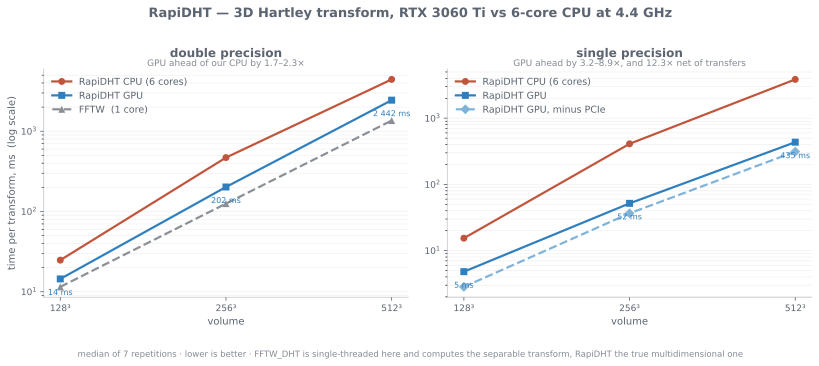

# Benchmarks

Everything below was measured on one machine: six cores at 4.4 GHz and an
RTX 3060 Ti (8 GiB), median of seven repetitions unless noted. Absolute numbers
say as much about that machine as about the library; the ratios are the point.

To reproduce, see [Running the benchmarks](#running-the-benchmarks) at the end.

---

## 3D volumes

This is what the library is for. `GPU` copies the volume across the bus on every
call, which is what the host-pointer overloads do; `Resident` keeps it on the
card through `DeviceVolume`.



| | CPU | GPU | Resident | Resident vs CPU |
| --- | ---: | ---: | ---: | ---: |
| f32 128³ | 1 586 µs | 2 129 µs | **261 µs** | 6.1× |
| f32 256³ | 18 467 µs | 17 684 µs | **3 035 µs** | 6.1× |
| f32 512³ | 247 634 µs | 160 305 µs | **44 157 µs** | 5.6× |
| f64 128³ | **2 811 µs** | 10 485 µs | 6 710 µs | 0.42× |
| f64 256³ | **40 449 µs** | 133 803 µs | 104 015 µs | 0.39× |
| f64 512³ | **442 164 µs** | 1 901 526 µs | 1 662 816 µs | 0.27× |

All columns from one run on 2026-11-06, after B-106
(`benchmarks/results/2026-11-06_evgeny.json`), `OMP_NUM_THREADS=6`. The device
figures agree with the previous run to within 2%; the CPU ones are 9–23× faster
than before B-106 (14 989 / 416 096 / 4 155 799 µs in f32 and 25 446 / 479 546 /
4 959 353 µs in f64). **In double precision the CPU now beats the GPU**, resident
or not, by 2.4–3.8×; in single precision the resident GPU leads by about 6×, not
the 57–136× this table used to show. The chart above predates both B-106 and
the removal of the device transposes and should be redrawn.

What the transposes cost, resident, f32:

| | before | after | |
| --- | ---: | ---: | ---: |
| 128³ | 800 µs | 264 µs | 3.0× |
| 256³ | 5 026 µs | 3 057 µs | 1.6× |
| 512³ | 58 202 µs | 44 758 µs | 1.3× |

The volume is stored `x` fastest, which cuBLAS reads as column-major, and every
`cas` matrix is symmetric, so each axis is one multiply on the data as it lies.
The path used to wrap them in four transposes and two Y/Z swaps, each a full
pass over the volume; the smaller the volume, the larger the share of the time
they took. In double precision they were never more than noise next to the FP64
GEMMs.

### The bus was hiding the transform

At 512³ the resident figure of 44.8 ms is the transform and nothing else.
Through the copying interface the same work is 1.5× the CPU backend;
resident, it is 5.6× (before B-106 these were 26× and 93×). The difference is the bus: 116 ms of it per call, measured
separately as the `PCIe` case, and 44.8 + 116.0 accounts for the 161 ms the
copying path takes.

The dense `cas` matrix is only `W × W` per axis and is reused once per line,
which turns the work into GEMMs — the case GPUs are built for — rather than the
memory-bound matrix-vector product that a single long 1D transform degenerates
into. The whole transform sustains 9.2 TFLOP/s against a 16.2 TFLOP/s peak,
counting the Bracewell pass as well as the GEMMs.

Of the 44.8 ms, the three GEMMs take about 40 and the Bracewell pass 4.9, timed
separately with CUDA events. A plain copy of the volume takes 2.6 ms, which is
the floor for any pass over it.

### Precision decides the outcome on consumer hardware

A GeForce runs FP64 at a fraction of its FP32 rate, so single precision is 26–38×
faster on the device, against 1.8–2.2× on the CPU. Anyone using the GPU backend
for volumes should be in `float`; in `double` the CPU backend is the faster one. On datacentre cards the ratio is 1:2 rather than
1:64 and the choice matters far less.

### Only 3D is worth offloading

In 2D the CPU is now faster at every size measured (1.4–2.3× in f32 at
128²–1024²). In 1D it is 66–80× slower: the axis is the
whole signal, so the matrix is `n × n`, and at n = 262 144 it would need 512 GiB.
The benchmark does not register GPU cases whose matrices exceed 1 GiB.

---

## Against cuFFT

cuFFT computes the Fourier transform, but for real input the Hartley transform
follows by one linear pass, `Re(X) − Im(X)`, so cuFFT plus an `O(N)` conversion
computes exactly what this library computes. That makes it the baseline that
matters.

At 512³ in single precision, both on data already resident on the device, both
measured in the same run:

| | time | arithmetic | achieved | extra device memory |
| --- | ---: | ---: | ---: | ---: |
| RapiDHT, matrix | 44.8 ms | 412 GFLOP | 9.2 TFLOP/s | **556 MiB** |
| cuFFT + conversion | **12.1 ms** | ~9 GFLOP | 0.75 TFLOP/s | 1 028 MiB |

(Measured with the first conversion pass; with the faster one of 2026-11-13 the
baseline is 10.74 ms — see the R-4 section below.)

**cuFFT is 3.7× faster on the transform.** That is the number to quote. The gap
narrows at smaller volumes -- 1.35× at 128³ and 2.0× at 256³ -- because an FFT's
advantage grows with the size of the problem, not shrinks.

Two measured facts sit alongside it:

- The matrix path performs about **46× more arithmetic** yet finishes only 3.7×
  behind, because it is compute-bound and reaches 57% of the card while an FFT
  is bandwidth-bound and reaches around 5%.
- It needs **about half the extra device memory** — 556 MiB, measured with
  `cudaMemGetInfo` (`profile_gpu3d`): 512 MiB of scratch, 3 MiB of matrices and
  about 41 MiB that the cuBLAS handle takes — against cuFFT's 1 028 MiB of
  spectrum and workspace, read from `cufftGetSize3d` (which leaves out cuFFT's
  own handle overhead). On this card that is a largest cubic volume of about 997³
  against about 871³.

  *Correction (B-003):* this table used to say 515 MiB while the transform, at
  construction, also allocated a host-staging buffer the size of the volume:
  it really held 1 068 MiB, more than cuFFT. Since B-003 that buffer is
  allocated on the first host-pointer call only. Measured on 2026-11-06
  (`benchmarks/results/2026-11-06_evgeny_memory.txt`), f32 512³: 556 MiB after
  construction and after resident use, 1 068 MiB once a host-pointer call has
  run; f64: 1 068 and 2 092 MiB.

The table settles neither of the two things that would decide the question. A
GEMM maps onto tensor cores and an FFT does not, so the gap is a property of the
card as much as of the algorithm. And the transform is one stage of a filtering
pipeline, where a Hartley spectrum multiplies an even kernel with a real
Hadamard product rather than a complex one.

### Tensor cores on this card

Measured with cuBLAS on the three 512³ GEMMs alone, outside the library:

| compute | GEMMs | rate | whole transform, estimated |
| --- | ---: | ---: | ---: |
| FP32 | 40.6 ms | 10 TFLOP/s | 44.8 ms (measured) |
| TF32 | 25.6 ms | 16 TFLOP/s | ~30 ms |
| FP16 in, FP32 accumulate | 13.2 ms | 31 TFLOP/s | ~18 ms |

The estimate adds the 4.9 ms Bracewell pass. None of them reaches cuFFT's
12.1 ms, and the lower precisions carry their own cost: TF32 keeps 10 bits of
mantissa, a relative error around 1e-3, which has not been checked against the
tolerances of the test suite.

On a GeForce, TF32 runs at the FP32 rate. The 32.4 TFLOP/s on the spec sheet is
the figure with structured sparsity, which a dense `cas` matrix cannot use; the
16 TFLOP/s measured here is the dense rate.

### Extrapolating to other hardware

Spec-sheet arithmetic, not measurement, and it points somewhere uncomfortable.
Dense rates throughout.

| | FP32 | TF32 tensor | bandwidth | FLOP/byte |
| --- | ---: | ---: | ---: | ---: |
| RTX 3060 Ti | 16.2 T | 16.2 T | 448 GB/s | 36 |
| A100 | 19.5 T | 156 T | 1 555 GB/s | 13 |
| H100 | 67 T | 495 T | 3 350 GB/s | 20 |

Scaling the 44.8 ms by the arithmetic rate, at the same efficiency, and cuFFT's
12.1 ms by the bandwidth. That flatters RapiDHT a little: its Bracewell pass is
bound by bandwidth too, and is scaled here as if it were arithmetic.

| at 512³ | RapiDHT, FP32 | RapiDHT, TF32 | cuFFT | gap, FP32 | gap, TF32 |
| --- | ---: | ---: | ---: | ---: | ---: |
| A100 | 37 ms | 4.7 ms | 3.5 ms | 10.7× behind | 1.3× behind |
| H100 | 11 ms | 1.5 ms | 1.6 ms | 6.7× behind | parity |

A datacentre card adds bandwidth first, and bandwidth is what an FFT runs on.
**Tensor cores are the condition for the approach staying viable on newer
hardware, but not enough to win**: even on an H100 they only bring it level,
and at TF32 precision. Beating cuFFT outright takes a fast algorithm with the
same few passes over memory, not faster multiplies.

---

## CPU backend after B-106

Two changes, both in `src/backend_cpu.cpp`:

- **Bracewell pass in place, by orbits.** Each output reads the separable
  spectrum only at its own point and at its mirror images, so the points split
  into orbits of up to 8 under the axis flips. Every orbit is read once and
  written once, with the fastest axis innermost. The full-size result buffer,
  the final copy and the strided `collapse(3)` loop are gone.
- **1D passes on blocks of 32 lines.** Neighbouring lines are gathered into a
  buffer laid out `[index along the axis][line]`, so every butterfly is a short
  contiguous loop across lines that the compiler vectorises, and the strided
  gather is paid once per block. No allocation per line any more.

Measured in a cloud container (Xeon @ 2.1 GHz, 2 threads, `-O3`, best of 3–5),
before and after, same machine, same run. Not comparable with the table above.

| | before | after | |
| --- | ---: | ---: | ---: |
| f32 128³ | 77.0 ms | 6.3 ms | 12× |
| f32 256³ | 932.7 ms | 58.7 ms | 16× |
| f64 128³ | 81.1 ms | 10.3 ms | 8× |
| f64 256³ | 1 411 ms | 126.4 ms | 11× |

The Bracewell share of the 256³ transform fell from 61–70% to 5–13%, and
`float` is now about twice as fast as `double` instead of on par, which is what
vectorised butterflies should give. For scale, `scipy.fft.rfftn` (pocketfft) on
the same container with 2 workers takes 6.1 ms at 128³ and 49.5 ms at 256³ in
`float` -- RapiDHT is within 1.05–1.2× of it while computing the true rather
than the separable transform. On the desktop, see the table at the top and
[FFTW, for reference](#fftw-for-reference).

---

## The separable transform (B-102)

`ForwardSeparable` skips the Bracewell pass; it is what an even-kernel
convolution runs. f32, `OMP_NUM_THREADS=6`, median of 7, 2026-11-06
(`benchmarks/results/2026-11-06_evgeny_separable.json`):

| | CPU | CPU separable | | Resident | Resident separable | |
| --- | ---: | ---: | ---: | ---: | ---: | ---: |
| 128² | 25.9 µs | 23.4 µs | −10% | 34.3 µs | 28.1 µs | −18% |
| 512² | 286 µs | 263 µs | −8% | 408 µs | 397 µs | −3% |
| 1024² | 1 301 µs | 1 258 µs | −3% | 3 018 µs | 2 978 µs | −1% |
| 128³ | 1 691 µs | 1 555 µs | −8% | 261 µs | 242 µs | −7% |
| 256³ | 18.6 ms | 15.7 ms | −15% | 3.01 ms | 2.84 ms | −6% |
| 512³ | 239 ms | 214 ms | −10% | 44.1 ms | 42.3 ms | −4% |

On the device the 3D saving is 1.85 ms at 512³, not the 4.9 ms the Bracewell
kernel takes: three out-of-place multiplies leave the separable spectrum in the
scratch buffer, and copying it back costs about 2.6 ms of the 4.9. Ending the
multiplies in the caller's buffer instead would need an in-place multiply or an
even number of passes. Either way the transform is GEMM-bound -- the
correction was never more than a tenth of it -- so skipping it is worth having
but does not change the picture.

---

## The factored device path (R-4, experimental)

`Modes::GPUFactored` replaces each dense `N x N` multiply by two small ones,
`N = N1 * N2` (512 = 32 * 16): 96 multiply-adds per element and axis instead
of 1 024. Each axis is one kernel that holds a block of lines in shared memory
and works in place; the Bracewell pass runs in place too. It holds no scratch
buffer, no matrices and no cuBLAS handle. Resident, f32, median of 7.
v2.2 -- one block of lines per thread block, 2026-11-06
(`benchmarks/results/2026-11-06_evgeny_factored_v2.2.json`); v2.3 -- a
pipelined grid that fetches the next block of lines into registers while it
computes the current one, with every shared-memory access laid out against bank
conflicts, 2026-11-13 (`…_2026-11-13_evgeny_factored_v2.3.json`; v2.2 from the
same build, `RAPIDHT_FACTORED_KERNEL=v2`, in `…_v2.2_samebuild.json`):

| | matrices | factored v2.2 | factored v2.3 | cuFFT + conversion | cuFFT R2C alone |
| --- | ---: | ---: | ---: | ---: | ---: |
| 128³ | 261 µs | 345 µs | 332 µs | **176 µs** | 133 µs |
| 256³ | 3.02 ms | 2.43 ms | 2.00 ms | **1.34 ms** | 1.01 ms |
| 512³ | 44.2 ms | 25.3 ms | 18.0 ms | **10.74 ms** | 8.11 ms |
| 512³, separable | — | 22.7 ms | 15.4 ms | — | — |
| 512³, f64 | 1 651 ms | **150 ms** | not measured | — | — |
| 1024², 2D | 3.04 ms | **0.29 ms** | not measured | — | — |
| extra device memory, 512³ f32 | 556 MiB | **32 MiB** | **32 MiB** | 1 028 MiB | 1 028 MiB |

The cuFFT columns are from 2026-11-13 (`…_r4_cufft_pairs.json`, R-4 step 0.3).
Before that the conversion pass looped over the outputs and read every stored
coefficient twice: 3.87 ms at 512³, and the baseline was quoted as 12.0 ms,
1.51 ms and 196 µs. The conversion now reads each coefficient once and writes
both H(k) and H(−k): 2.62 ms, the time of one copy of the volume. The baseline
is to be beaten at its strongest, so the faster one is the only one kept.
cuFFT's 1 028 MiB are the half spectrum (514 MiB) plus the workspace
`cufftGetSize3d` reports (514 MiB); an in-place R2C would need rows padded to
2(W/2 + 1) floats, which this library's layout does not have.

The 32 MiB are the CUDA memory pool's granularity; the tables themselves are
a few KiB. Per kernel at 512³ f32 (`RAPIDHT_TRACE_KERNELS=1`, after warm-up),
against about 2.4 ms for one read and one write of the volume:

| | x (fastest) | y | z | Bracewell |
| --- | ---: | ---: | ---: | ---: |
| v2.2 | 8.6 ms | 6.9 ms | 6.9 ms | 2.6 ms |
| v2.3 | 3.9–4.3 ms | 5.1–5.7 ms | 5.9–6.3 ms | 2.6 ms |

Bracewell already runs at the bus limit. In v2.3 the fastest axis is the
quickest and y and z are now the slow ones. Why is not established: v2.3
changed three things at once (the pipeline, the shared-memory layout, moving
lines in quads), and the per-axis difference has not been isolated by a
measurement. The float result at these extents is checked against the CPU
backend by `FactoredFloatAgreesWithCpuOnBenchmarkExtents_GPU`; single-precision
error, measured on the device against the CPU backend in double
(`benchmarks/accuracy_gpu3d`, `…_r4_accuracy.txt`), relative to the RMS of
the spectrum of zero-mean noise:

| | 256³ largest | 256³ RMS | 512³ largest | 512³ RMS |
| --- | ---: | ---: | ---: | ---: |
| cuFFT + conversion | 1.41e-5 | 2.76e-7 | 1.92e-5 | 3.17e-7 |
| factored | 1.12e-5 | 2.02e-7 | 6.31e-5 | 2.39e-7 |
| matrices | 3.16e-4 | 4.18e-5 | 7.36e-4 | 8.42e-5 |

**Largest volume on the 8 GB card, float** (`…_r4_1024.txt`, R-4 step 0.5):
the factored path transforms 1024³ (4 GiB) in place in 198 ms, holding the
same 32 MiB beside the volume. The cuFFT baseline does not fit: with the volume
resident about 2 970 MiB remain, and the half spectrum alone is 4 104 MiB
(`cufftPlan3d` returned code 5, `CUFFT_INTERNAL_ERROR`). At 1024³ the axes run
at 2.4–3.1 times the copy time against 1.5–2.3 at 512³; one block per SM fits
there (77 KiB of shared memory), which is a likely but unmeasured cause.

The factored path has the smaller RMS error at both sizes, but at 512³ its
largest error is 3.3 times cuFFT's (backlog R-4a). The matrix path sums each
output over the whole axis in one dot product and is 20–40 times less
accurate than either.
The review of this track and the plan from here are in `docs/R4_PLAN.md`.

---

## FFTW, for reference

`FFTW_DHT` in double takes 15 871 / 144 146 / 1 500 455 µs on the same volumes
(2026-11-06; run-to-run variation 18% / 2% / 11%, the noisiest figures here).
The CPU backend in double takes 2 811 / 40 449 / 442 164 µs: 3.4–5.6× faster.
Before B-106 it was 2.2–3.4× slower.

That is not "faster than FFTW". FFTW here runs on one thread against our six,
and in 2D/3D it computes the *separable* transform while RapiDHT computes the
true multidimensional one, Bracewell pass included. A like-for-like comparison
needs either FFTW with threads or this backend with `OMP_NUM_THREADS=1`.

---

## Known openings

- ~~The CPU backend gains almost nothing from `float`~~ — addressed by B-106
  (blocks of lines, vectorised butterflies); `float` is now 1.8–2.2× `double`.
- CPU throughput still falls with size, though from a much higher level: in
  f32 1 320, 910 and 540 M points/s at 128³, 256³ and 512³ (before B-106: 140,
  40 and 32). The 128³ volume fits in the 18 MiB L3, the others do not; each of
  the three 1D passes and the Bracewell pass still stream the whole volume.
- 1024³ does not fit on an 8 GiB card in any precision: two buffers of 4 GiB
  each in `float`. Volumes beyond ~997³ need slab decomposition.
- The Bracewell pass takes 4.9 ms at 512³ against the 2.6 ms of a plain copy.
  It reads four points per output, three of them mirrored, where a copy reads
  one.
- `profile_gpu3d` used to loop over the host-pointer overload, so it reported
  175.7 ms and 2.35 TFLOP/s at 512³ where the transform then took 58.2 ms and
  reached 7.1. It now runs on a `DeviceVolume`. Worth remembering that the
  measurement error and the thing being measured were the same mistake.

---

## Running the benchmarks

```bash
cmake -S . -B build-bench -DCMAKE_BUILD_TYPE=Release \
      -DRAPIDHT_BUILD_BENCHMARKS=ON -DRAPIDHT_WITH_CUDA=ON
cmake --build build-bench -j

export OMP_NUM_THREADS=6          # physical cores, not logical
mkdir -p benchmarks/results
./build-bench/benchmarks/bench_transform \
  --benchmark_repetitions=7 --benchmark_report_aggregates_only=true \
  --benchmark_out=benchmarks/results/$(date +%F)_$(hostname).json \
  --benchmark_out_format=json
```

Always keep `--benchmark_out`: the console table is not saved anywhere, while
the JSON holds every figure plus the machine context (CPU, frequency, caches,
build type), so a run can be read back later -- by Claude too -- without
copying console output. One file per run, named by date and machine, in
`benchmarks/results/` rather than `build-bench/`, which is a build directory
and gets wiped.

Enabling benchmarks makes the configure step fetch Google Benchmark. An
`FFTW_DHT` baseline is built when FFTW is visible to `pkg-config`; the cuFFT
baseline is built whenever CUDA is on, and checks itself against this library's
own GPU path before reporting a number.

For a kernel-level breakdown:

```bash
./build-bench/benchmarks/profile_gpu3d 512 10 f32
nsys profile --stats=true ./build-bench/benchmarks/profile_gpu3d 512 10 f32
```
